# THM Investigating Windows — SOC Investigation Writeup

> Forensik Windows: menelusuri jejak penyerang pada mesin Windows Server 2016 yang telah dikompromikan.

| Item | Keterangan |
|---|---|
| Platform / Room | TryHackMe — Investigating Windows (completed 100%) |
| Target | Windows Server 2016 Datacenter (`EC2AMAZ-I8UHO76`) via RDP |
| Alat | PowerShell, `net`, Event Viewer, Task Scheduler, `wf.msc`, File Explorer, Notepad |
| Jumlah soal | 15 |


## Ringkasan Eksekutif

Aktivitas penyerang terkonsentrasi pada **2 Maret 2019** (sekitar 16:04–17:48). Penyerang menanam persistence lewat Registry Run key dan scheduled task, menyiapkan perkakas di `C:\TMP` (termasuk Mimikatz), mengunggah web shell JSP, membuka port 1337 lewat `netsh`, dan memanipulasi file `hosts` untuk memblokir update keamanan serta mengarahkan `google.com` ke C2 eksternal `76.32.97.132`.

## Ringkasan Jawaban

| No | Pertanyaan | Jawaban |
|---|---|---|
| 1 | Version and year of the Windows machine | **Windows Server 2016** |
| 2 | Which user logged in last? | **Administrator** |
| 3 | When did John log on last? | **03/02/2019 5:48:32 PM** |
| 4 | IP the system connects to at first start | **10.34.2.3** |
| 5 | Two admin accounts (besides Administrator) | **Guest, Jenny** |
| 6 | Malicious scheduled task | **Clean file system** |
| 7 | File the task runs daily | **nc.ps1** |
| 8 | When did Jenny last log on? | **Never** |
| 9 | Date of the compromise | **03/02/2019** |
| 10 | Time special privileges first assigned to a new logon | **03/02/2019 4:04:49 PM** |
| 11 | Tool used to get Windows passwords | **Mimikatz** |
| 12 | Attacker external C2 IP | **76.32.97.132** |
| 13 | Extension of the uploaded shell | **.jsp** |
| 14 | Last port the attacker opened | **1337** |
| 15 | DNS poisoning — site targeted | **google.com** |

## Hasil Investigasi

### Soal 1 — Versi dan tahun Windows

**Jawaban:** Windows Server 2016

Dari **Settings → System → About**: Windows Server 2016 Datacenter, versi 1607, OS Build 14393.2791. Lewat terminal:

```powershell
Get-ComputerInfo
```

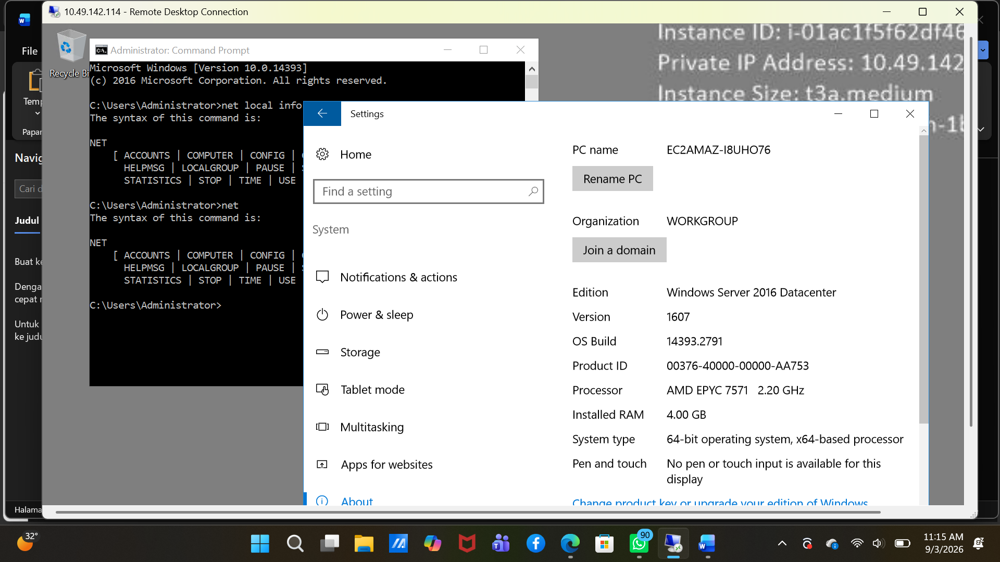

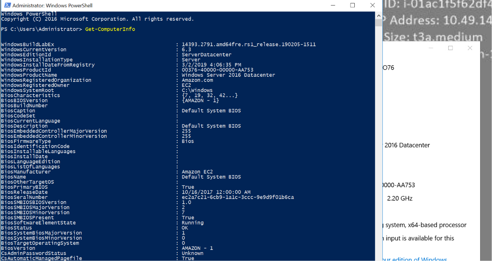

### Soal 2 — User yang login terakhir

**Jawaban:** Administrator

Event Viewer (`eventvwr`) → Security menampilkan aktivitas `Administrator`; dikonfirmasi lewat PowerShell:

```powershell
whoami
Get-LocalUser | Select-Object Name, LastLogon
```

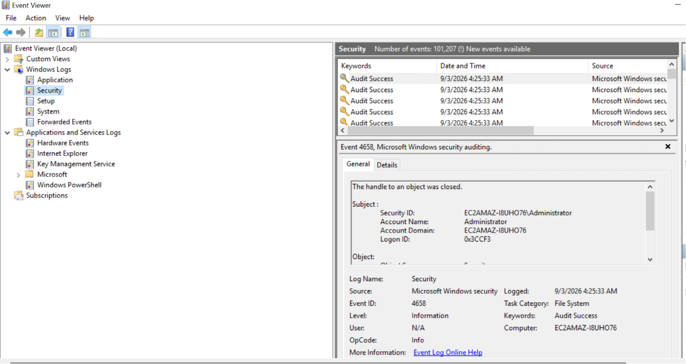

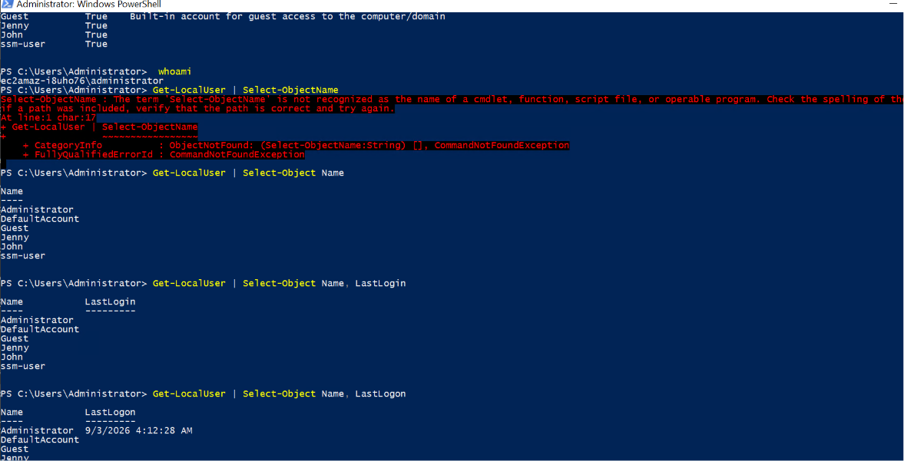

> **Catatan:** login terakhir Administrator bertanggal 9/3/2026 (sesi RDP investigasi), kemungkinan besar bukan aktivitas penyerang.

### Soal 3 — Login terakhir John

**Jawaban:** 03/02/2019 5:48:32 PM

```powershell
Get-LocalUser | Select-Object *
Get-LocalUser | Select-Object Name, LastLogon | Sort-Object LastLogon -Descending
net user john
```

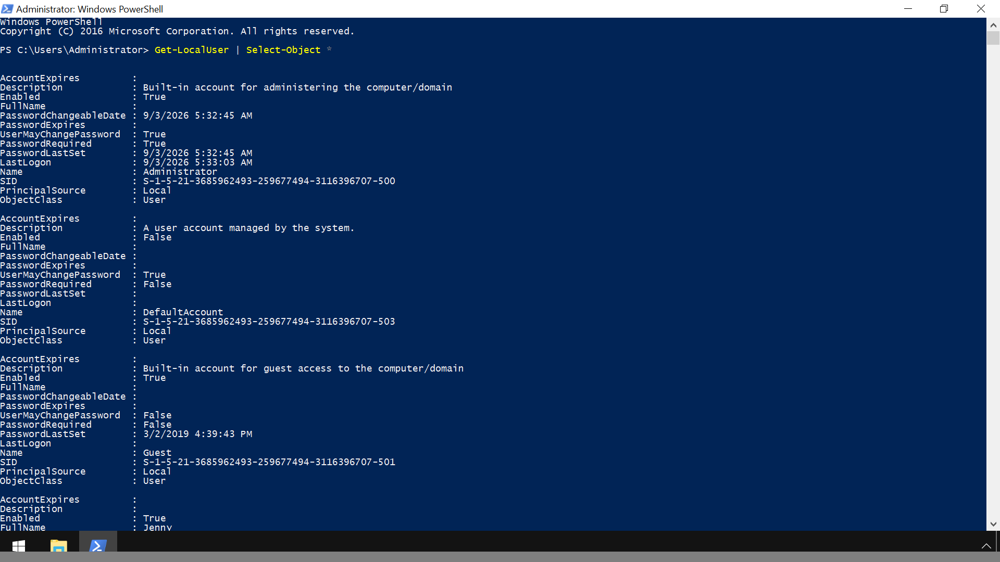

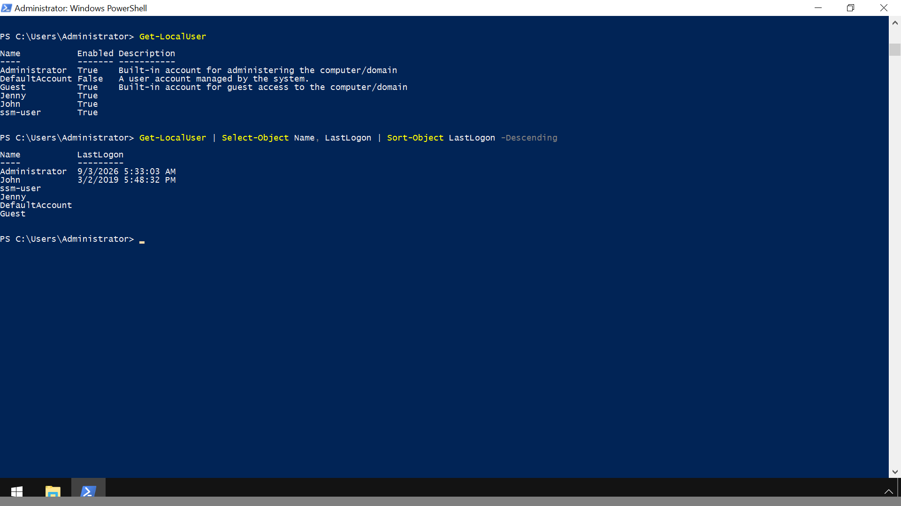

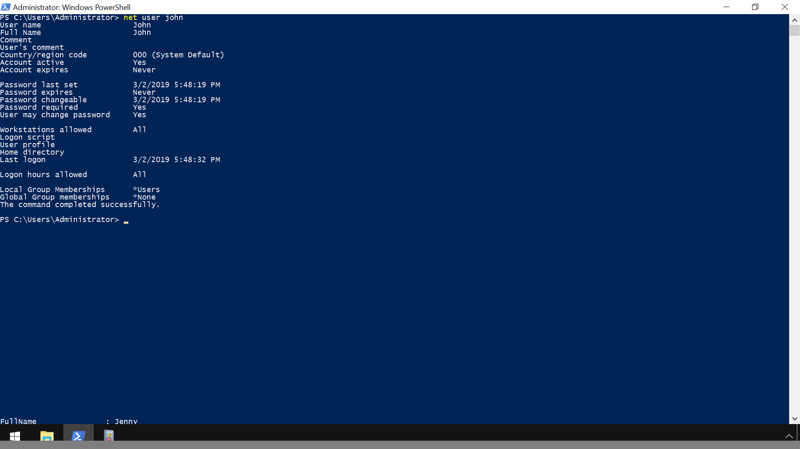

> **Catatan:** password John di-set 5:48:19 PM, ±13 detik sebelum login terakhir; pola umum akun yang baru dibuat.

### Soal 4 — IP yang dihubungi saat sistem start

**Jawaban:** 10.34.2.3

Pertanyaan ini menanyakan program yang berjalan otomatis saat start. `Win32_StartupCommand` merangkum Startup folder dan Registry Run key:

```powershell
Get-WmiObject Win32_StartupCommand | Select-Object Name, Command, Location | Format-List
```

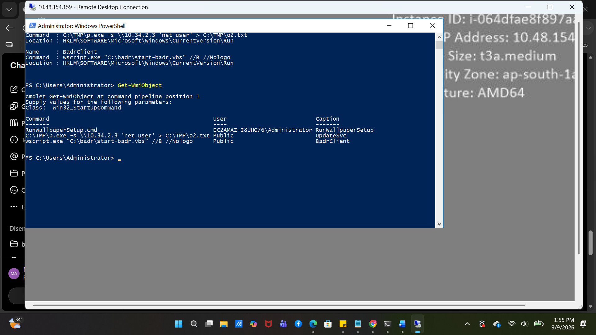

| Nama | Command | Lokasi |
|---|---|---|
| RunWallpaperSetup | `RunWallpaperSetup.cmd` | Startup folder |
| **UpdateSvc** | `C:\TMP\p.exe -s \\10.34.2.3 'net user' > C:\TMP\o2.txt` | `HKLM\SOFTWARE\Microsoft\Windows\CurrentVersion\Run` |
| BadrClient | `wscript.exe "C:\badr\start-badr.vbs" //B //Nologo` | `HKLM\...\Run` |

> **Catatan:** `10.34.2.3` adalah IP privat (kemungkinan target lateral movement), bukan C2 eksternal (lihat Soal 12). Kemiripan `p.exe` dengan PsExec masih hipotesis.

### Soal 5 — Akun dengan hak administrator

**Jawaban:** Guest, Jenny

```powershell
net localgroup
net localgroup administrators
```

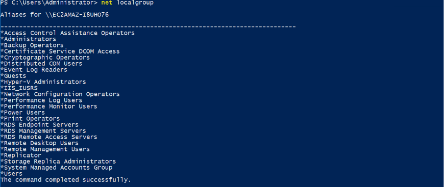

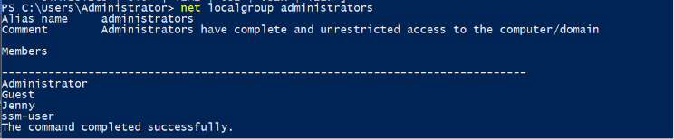

> **Catatan:** `Guest` berstatus Enabled dan menjadi admin (tidak wajar). `ssm-user` kemungkinan akun AWS Systems Manager milik infrastruktur lab.

### Soal 6 — Scheduled task berbahaya

**Jawaban:** Clean file system

Kolom `Actions` hanya menampilkan tipe objek, jadi dibuat calculated property untuk membuka `Actions.Execute` dan `Actions.Arguments`:

```powershell
Get-ScheduledTask | Where-Object { $_.TaskPath -eq "\" } |
    Select-Object TaskName, State, Author, Description,
        @{N="Cmd";E={$_.Actions.Execute}},
        @{N="Args";E={$_.Actions.Arguments}} |
    Format-List
```

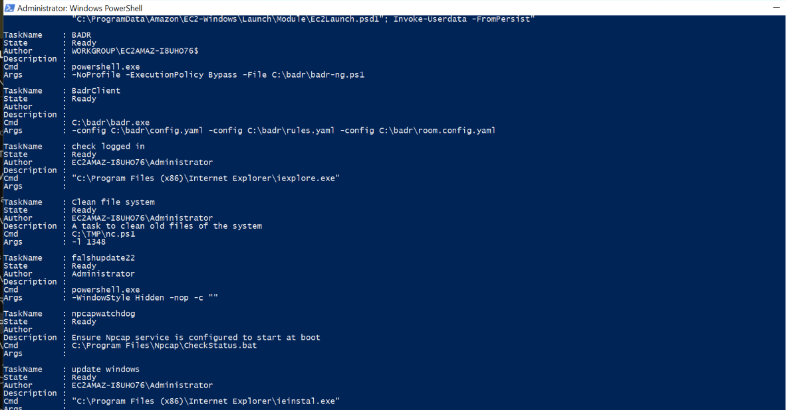

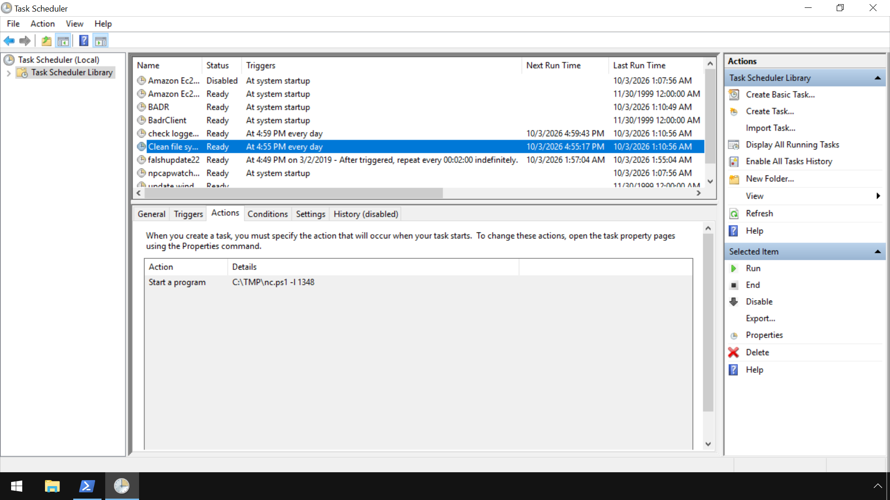

Task menjalankan `C:\TMP\nc.ps1 -l 1348` (Netcat versi PowerShell, mode listen port 1348), disamarkan dengan deskripsi "A task to clean old files of the system".

> **Catatan:** `falshupdate22` (PowerShell tersembunyi) juga mencurigakan. Filter `TaskPath -eq "\"` hanyalah heuristik triase, bukan jaminan.

### Soal 7 — File yang dijalankan harian

**Jawaban:** nc.ps1

```powershell
Get-ScheduledTask | Where-Object { $_.Triggers.CimClass.CimClassName -eq "MSFT_TaskDailyTrigger" } |
    Select-Object TaskName, TaskPath, State, Author,
        @{N="Cmd";E={$_.Actions.Execute}}, @{N="Args";E={$_.Actions.Arguments}}
```

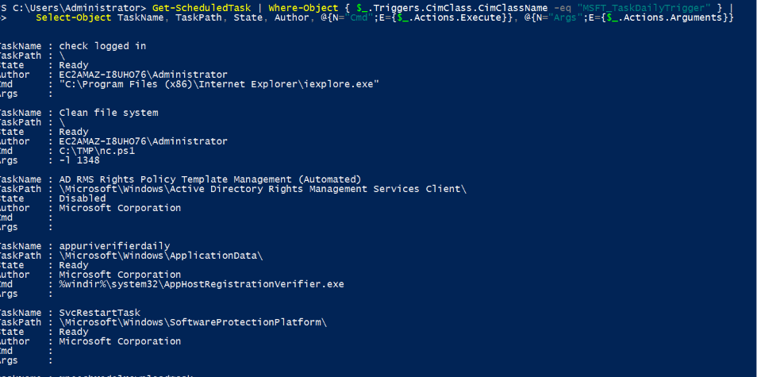

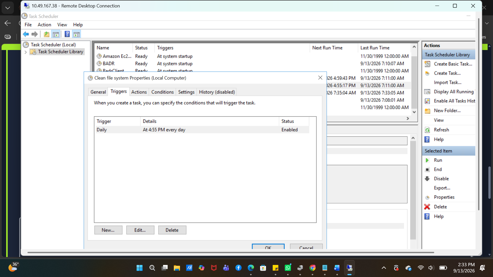

### Soal 8 — Login terakhir Jenny

**Jawaban:** Never

```powershell
Get-LocalUser | Format-List *
Get-LocalUser | Select-Object FullName, LastLogon | Format-Table -AutoSize
```

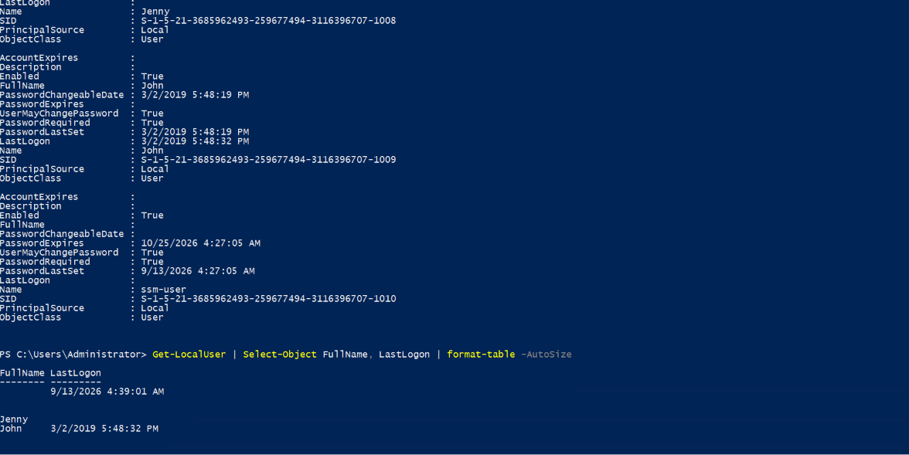

> **Catatan:** Jenny adalah admin tetapi belum pernah login; layak dicurigai sebagai akun cadangan.

### Soal 9 — Tanggal kompromi

**Jawaban:** 03/02/2019

```powershell
Get-ScheduledTask -TaskName "Clean file system" | Format-List *
```

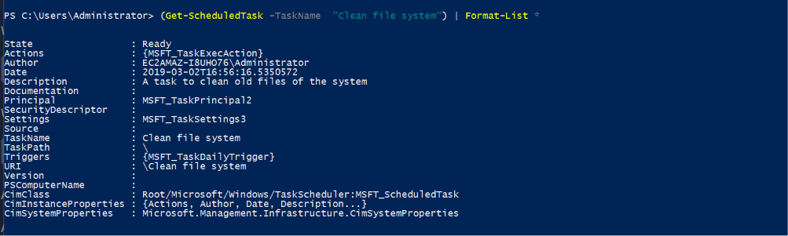

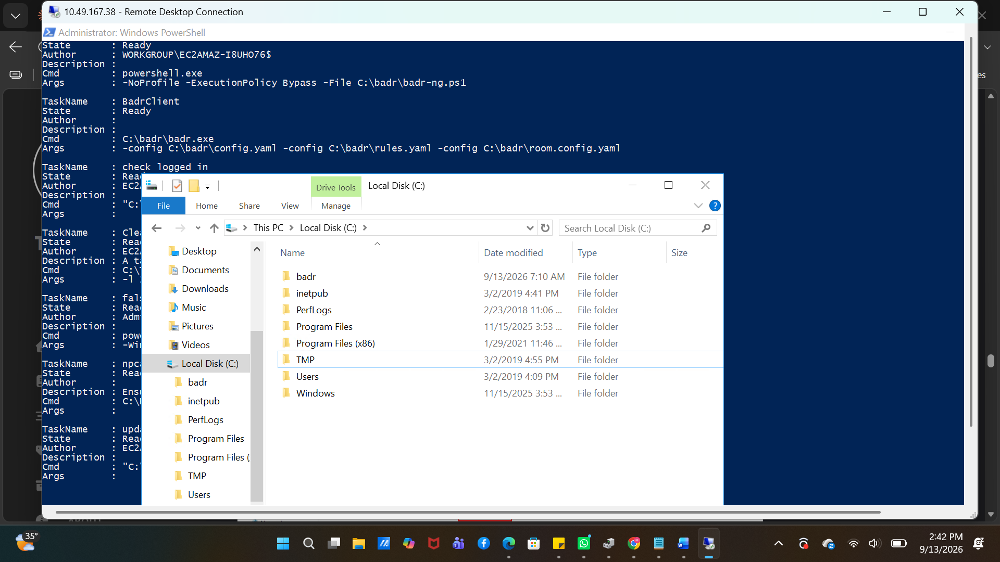

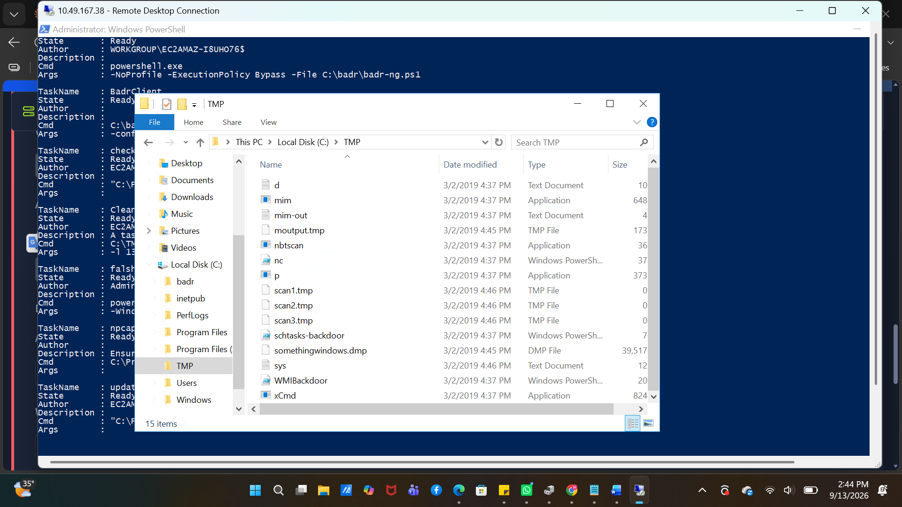

Field `Date` task (2019-03-02T16:56:16), folder `C:\TMP`, `C:\inetpub`, dan `C:\Users`, serta file perkakas di `C:\TMP` semuanya bertanggal 3/2/2019.

> **Catatan:** `Date` pada task dan timestamp filesystem sama-sama bisa dimanipulasi, jadi kesimpulan dikuatkan dengan kesesuaian banyak artefak.

### Soal 10 — Waktu special privileges pertama

**Jawaban:** 03/02/2019 4:04:49 PM

Logon dengan hak istimewa dicatat sebagai **Event ID 4672**. Langkah: Event Viewer → Windows Logs → Security → Filter Current Log → isi `4672` → cari entri yang cocok dengan hint (detik ke-49).

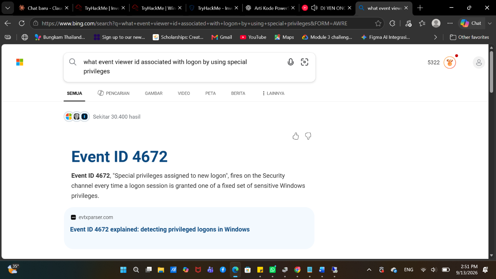

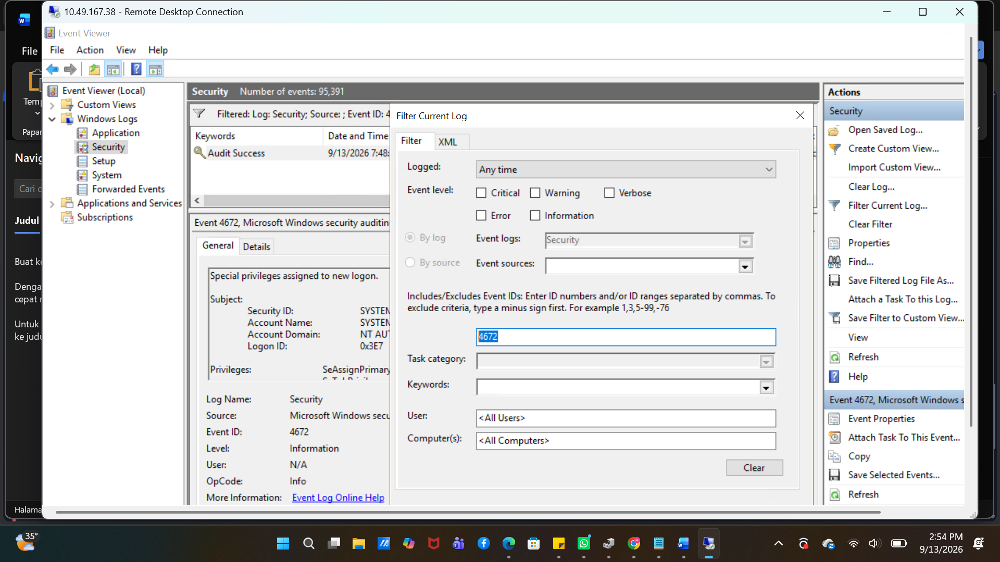

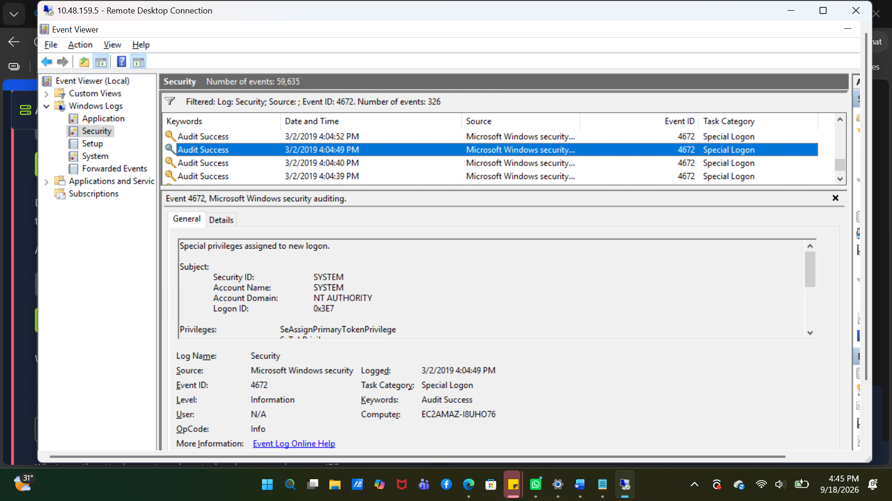

> **Catatan:** ada event 4672 lain yang berdekatan (4:04:39–4:04:52 PM); pemilihan 4:04:49 PM dibantu hint soal.

### Soal 11 — Tool pencuri password

**Jawaban:** Mimikatz

Task berbahaya berada di `C:\TMP`, jadi isinya diperiksa. File `mim-out` berisi banner Mimikatz dan perintah:

```text
mimikatz(powershell) # sekurlsa::logonpasswords
```

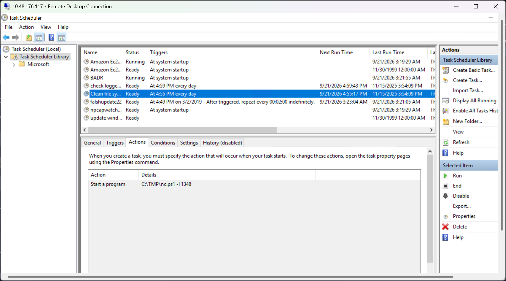

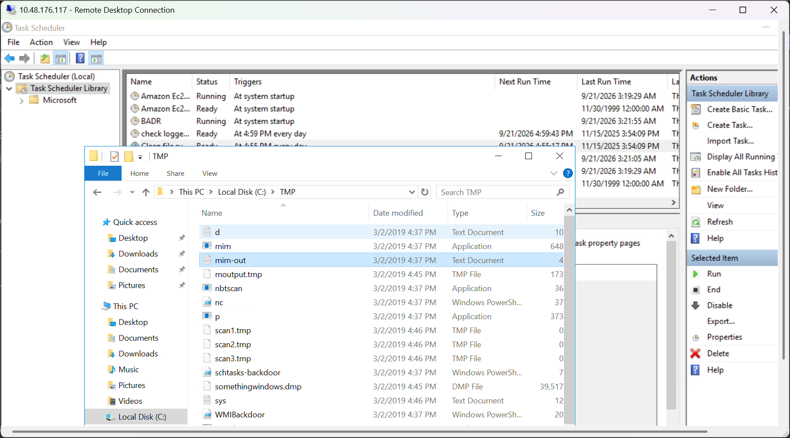

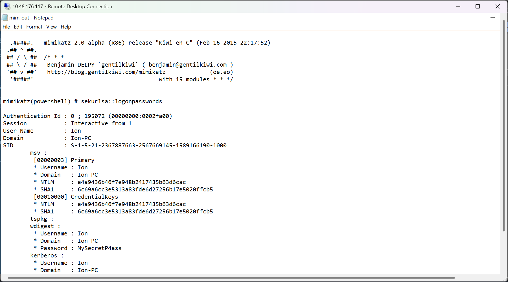

`sekurlsa::logonpasswords` membaca material kredensial dari memori proses, terutama LSASS (hash NTLM/SHA1, WDigest, Kerberos).

### Soal 12 — IP C2 eksternal

**Jawaban:** 76.32.97.132

File `hosts` (`C:\Windows\System32\drivers\etc\hosts`) dimodifikasi 3/2/2019 5:31 PM:

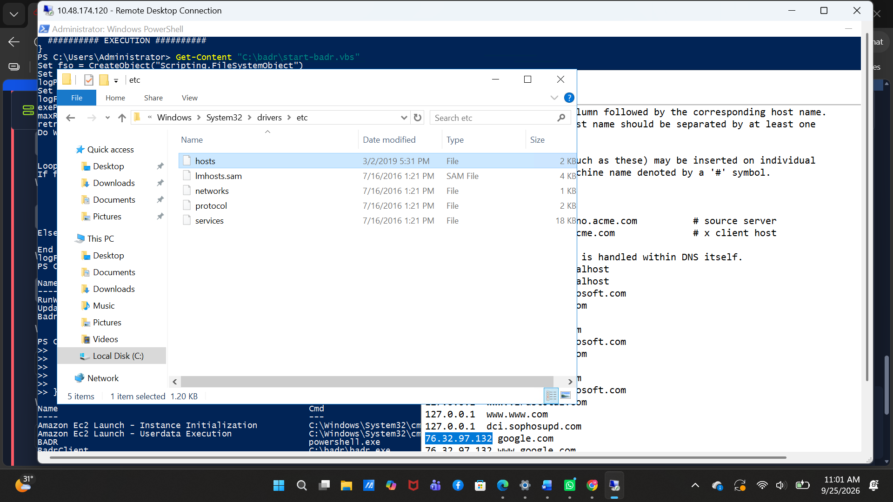

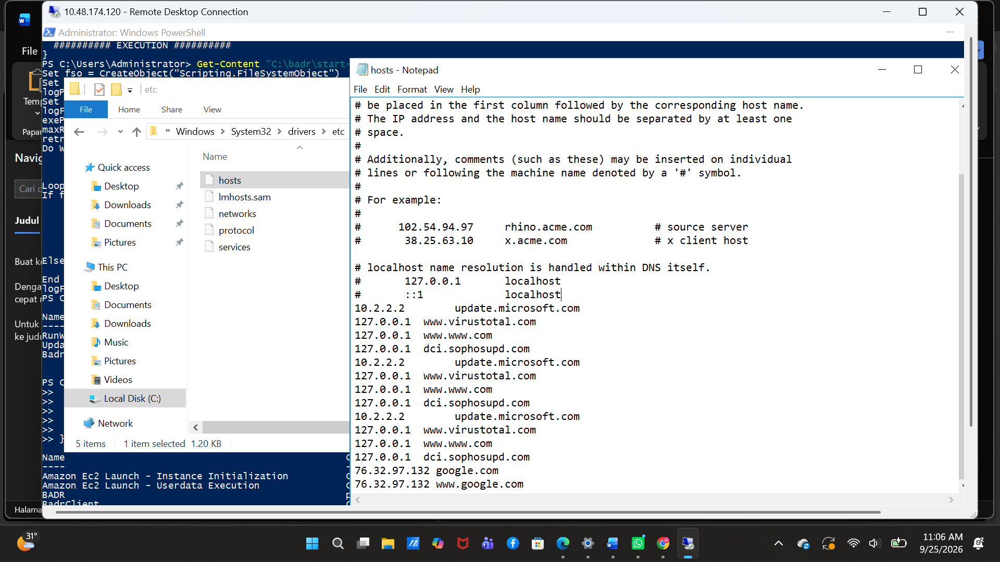

| IP | Domain | Interpretasi |
|---|---|---|
| 127.0.0.1 | www.virustotal.com, dci.sophosupd.com, www.www.com | Diblok (cek reputasi dan update Sophos gagal) |
| 10.2.2.2 | update.microsoft.com | Windows Update dialihkan ke IP internal |
| **76.32.97.132** | **google.com, www.google.com** | Server C2 penyerang |

### Soal 13 — Ekstensi shell yang diunggah

**Jawaban:** .jsp

Tidak ada listener web maupun layanan IIS aktif (`Get-NetTCPConnection`, `Get-Service W3SVC`), tetapi folder `C:\inetpub\wwwroot` ada, berarti web server pernah terpasang.

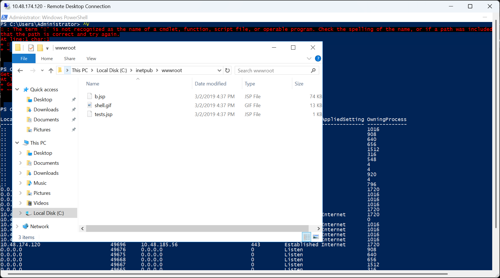

| File | Ukuran | Catatan |
|---|---|---|
| b.jsp | 74 KB | Kandidat kuat web shell |
| tests.jsp | 1 KB | Berekstensi .jsp |
| shell.gif | 13 KB | Nama "shell" dengan ekstensi gambar, kemungkinan penyamaran |

### Soal 14 — Port terakhir yang dibuka

**Jawaban:** 1337

Agar penyerang bisa terhubung dari luar, firewall harus mengizinkan koneksi **masuk (Inbound)** ke port listener. Rule buatan penyerang biasanya tanpa Group, berbeda dengan rule bawaan Windows. Buka `wf.msc` → Inbound Rules.

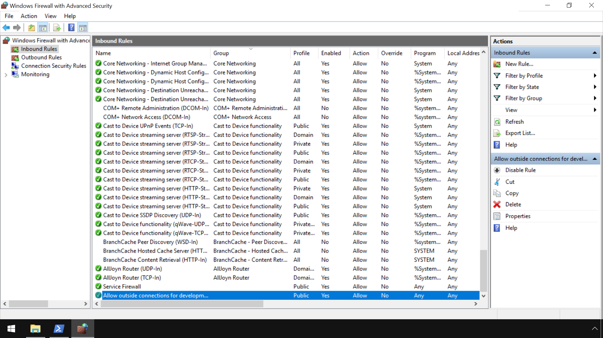

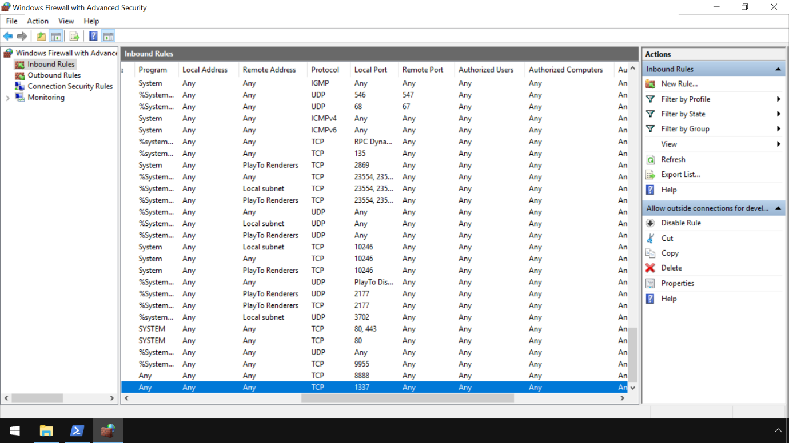

Bukti tambahan di log firewall (Event ID 2004): rule dibuat lewat `C:\Windows\System32\netsh.exe` oleh akun dengan RID -500 (Administrator).

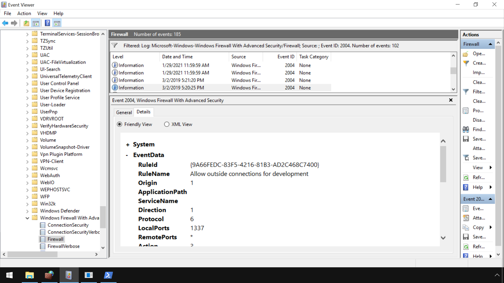

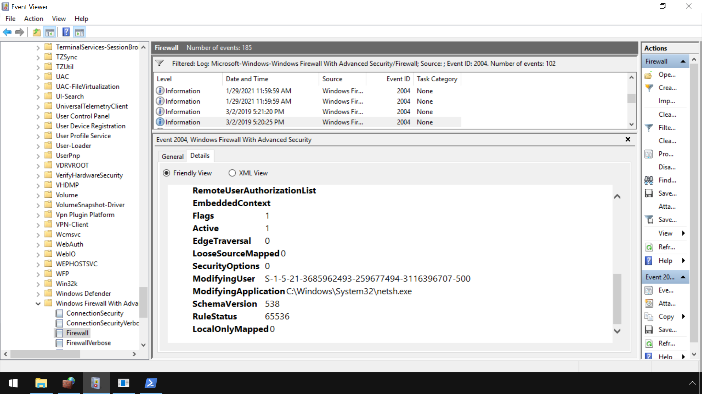

> **Catatan:** port **1348** adalah listener `nc.ps1` (Soal 6), sedangkan **1337** dibuka lewat rule firewall.

### Soal 15 — Situs target DNS poisoning

**Jawaban:** google.com

File `hosts` memetakan `google.com` dan `www.google.com` ke `76.32.97.132`, bukan IP milik Google.

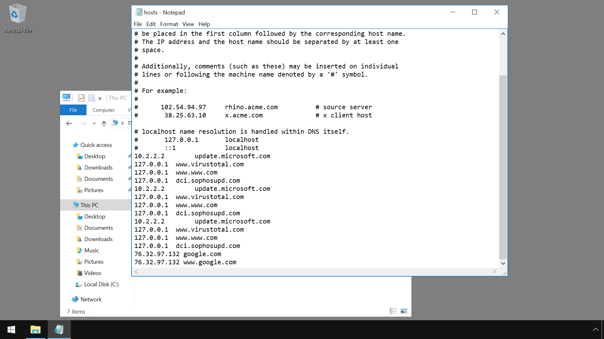

> **Catatan:** secara teknis ini manipulasi file `hosts` (local DNS poisoning), bukan poisoning cache DNS server.

## Timeline (2 Maret 2019)

| Waktu | Peristiwa |
|---|---|
| 4:04:49 PM | Event 4672 (special privileges, SYSTEM) |
| 4:09 PM | Folder `C:\Users` dimodifikasi |
| 4:37 PM | Perkakas di `C:\TMP` dan file JSP/GIF di wwwroot |
| 4:41 PM | Folder `C:\inetpub` dimodifikasi |
| 4:45–4:46 PM | File output sementara (moutput, scan1–3) |
| 4:49 PM | Trigger awal task `falshupdate22` |
| 4:55 PM | `C:\TMP` dimodifikasi; jadwal harian Clean file system |
| 4:56:16 PM | Task Clean file system didaftarkan |
| 5:31 PM | File `hosts` dimodifikasi |
| 5:48:19 PM | Password John di-set |
| 5:48:32 PM | Login terakhir John |

## IOC

| Tipe | Indikator |
|---|---|
| IP eksternal | `76.32.97.132` (C2) |
| IP internal | `10.34.2.3`, `10.2.2.2` |
| Registry | `HKLM\SOFTWARE\Microsoft\Windows\CurrentVersion\Run\UpdateSvc` |
| Scheduled task | `Clean file system`, `falshupdate22` |
| File | `C:\TMP\nc.ps1`, `p.exe`, `mim`, `mim-out`, `nbtscan`, `xCmd`, `somethingwindows.dmp` |
| Web shell | `C:\inetpub\wwwroot\b.jsp`, `tests.jsp`, `shell.gif` |
| Port | 1348/TCP (nc.ps1), 1337/TCP (rule "Allow outside connections for development") |
| Akun | `Guest` (admin), `Jenny` (admin, belum pernah login) |

## MITRE ATT&CK (indikatif)

| ID | Teknik | Bukti |
|---|---|---|
| T1547.001 | Registry Run Keys | UpdateSvc |
| T1053.005 | Scheduled Task | Clean file system, falshupdate22 |
| T1003.001 | LSASS Memory | Mimikatz `sekurlsa::logonpasswords` |
| T1505.003 | Web Shell | File `.jsp` di wwwroot |
| T1562.004 | Disable or Modify System Firewall | Rule TCP 1337 via netsh |
| T1562.001 | Disable or Modify Tools | `hosts` memblokir Sophos dan VirusTotal |
| T1087.001 | Local Account Discovery | `net user` pada UpdateSvc |

## Pelajaran

- Cari persistence dulu (Run key, Startup folder, scheduled task); itu menjawab "apa yang berjalan saat start" lebih baik daripada snapshot koneksi aktif.
- Jangan percaya nama task atau rule; periksa command dan argumen sebenarnya.
- Buka properti bersarang (`Actions.Execute`, `Triggers.CimClass.CimClassName`) lewat calculated property.
- Korelasikan timestamp lintas sumber.
- Periksa file `hosts` dan rule firewall tanpa Group.
