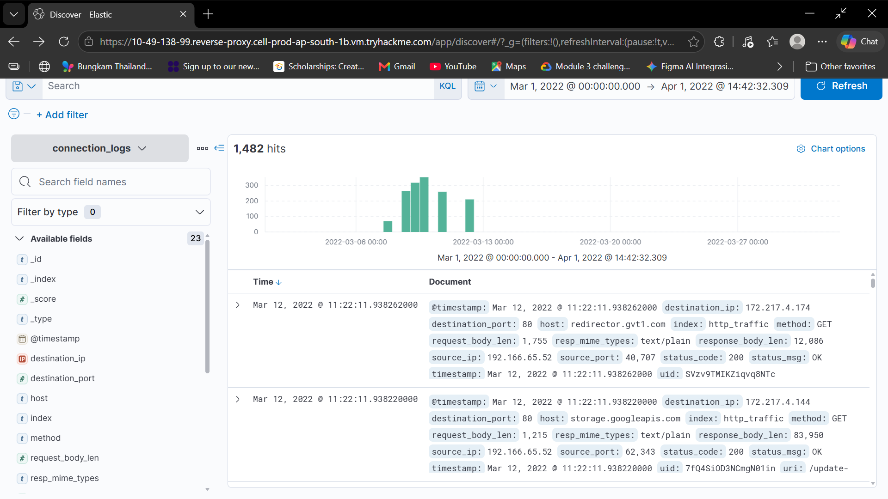
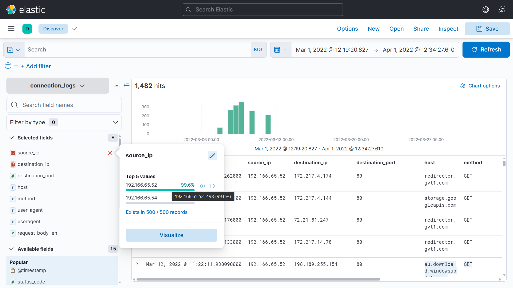
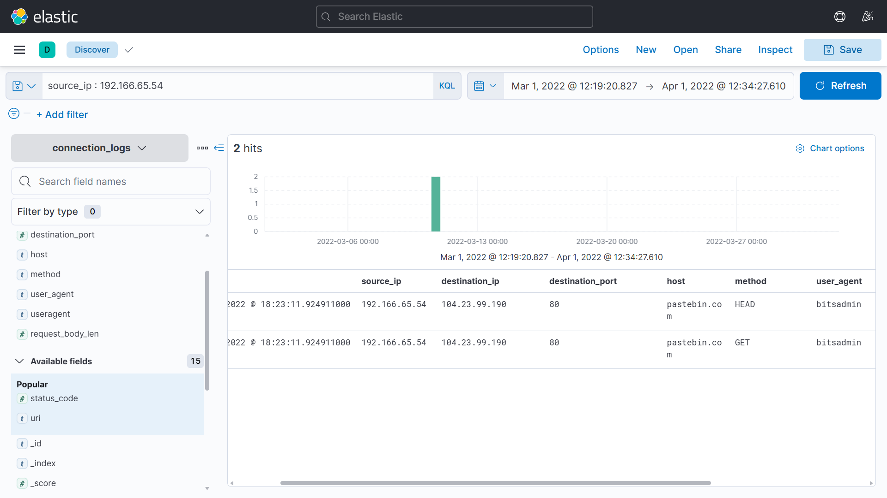
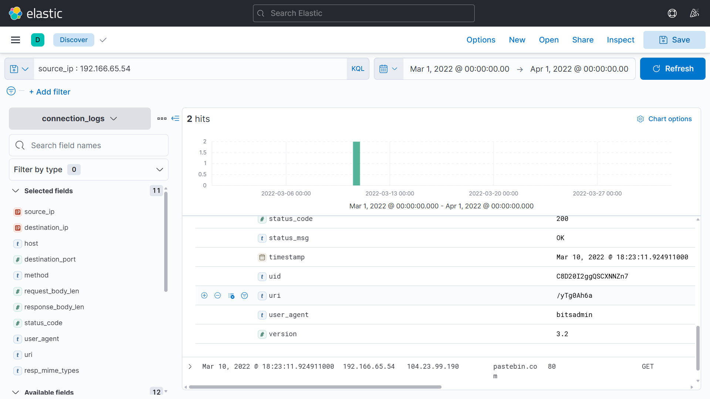
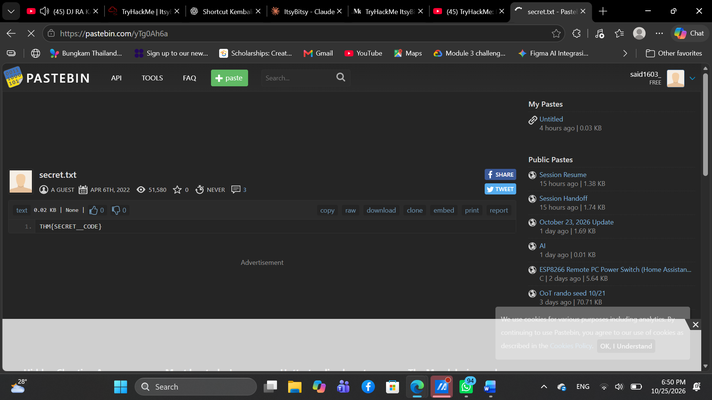

# TryHackMe - ItsyBitsy Writeup

**Room:** ItsyBitsy (SOC Level 1 > SIEM Triage for SOC)
**Tools:** Elastic / Kibana (Discover, KQL)
**Topik:** investigasi dugaan komunikasi C2 dari connection logs

## Skenario

Saat monitoring SOC, Analyst **John** melihat alert dari IDS yang menunjukkan potensi komunikasi C2 dari user **Browne** (departemen HR). Sebuah file mencurigakan diakses dan berisi pola `THM:{ ________ }`. Log koneksi HTTP selama seminggu sudah ditarik dan dimasukkan ke index `connection_logs` di Kibana.

---

## 1. How many events were returned for the month of March 2022?

**Jawaban: `1482`**

Atur rentang waktu di Kibana Discover dari **1 Maret 2022 00:00:00** sampai **1 April 2022 00:00:00** (sesuaikan dengan tampilan dashboard-mu), lalu pilih index `connection_logs`. Rentang dibuat tepat satu bulan karena pertanyaannya hanya menghitung event bulan Maret 2022. Jumlahnya terlihat di kiri atas (1482 hits).

Setelah itu, tambahkan kolom `source_ip`, `destination_ip`, `destination_port`, `host`, `method`, dan `user_agent` dari panel "Available fields" supaya setiap event bisa dibaca sekilas tanpa membuka detailnya satu per satu.



---

## 2. What is the IP associated with the suspected user in the logs?

**Jawaban: `192.166.65.54`**

Skenario menyebut adanya indikasi komunikasi C2 dari mesin milik user Browne (HR), jadi mesin tersebut diduga sudah ter-compromise. Tugas kita adalah mencari `source_ip` mana yang berperilaku mencurigakan, dimulai dengan melihat sebaran nilai `source_ip` (klik field `source_ip` di sidebar) untuk mengetahui host internal apa saja yang ada di log.



Awalnya aku mengira `192.166.65.52` adalah IP yang dicurigai karena IP ini mendominasi log (sekitar 99,6% dari 500 event sampel yang ditampilkan Kibana). Namun, pada event yang terlihat IP ini hanya menghubungi domain umum seperti `redirector.gvt1.com`, `storage.googleapis.com`, dan `au.download.windowsupdate.com`, yang merupakan traffic normal. Volume traffic yang besar belum tentu berbahaya; traffic C2 justru sering kecil dan jarang, sehingga IP dengan jumlah event sedikit (`192.166.65.54`) perlu dicek.

Lalu aku memfilter dengan KQL:

```
source_ip : 192.166.65.54
```

Hasilnya hanya 2 event (HEAD dan GET) ke `pastebin.com` dengan `user_agent` `bitsadmin`, sehingga IP inilah yang diduga melakukan komunikasi C2.



---

## 3. The user's machine used a legit windows binary to download a file from the C2 server. What is the name of the binary?

**Jawaban: `bitsadmin`**

Dari filter di pertanyaan sebelumnya, `user_agent` dari IP `192.166.65.54` adalah `bitsadmin`, yaitu tool bawaan Windows (legitimate binary) yang bisa dipakai untuk mengunduh file. Penyerang sering memakainya agar aktivitas download terlihat sah dan lolos dari deteksi. Teknik memakai tool bawaan sistem seperti ini disebut **Living Off The Land (LOLBin)** dan dipetakan di MITRE ATT&CK sebagai **T1197 (BITS Jobs)**.

BITS (Background Intelligent Transfer Service) adalah layanan Windows yang menangani transfer data di latar belakang. Transfer dapat dilanjutkan ketika koneksi terputus, sehingga cocok untuk mengunduh file berukuran besar atau pembaruan sistem. `bitsadmin.exe` adalah command-line tool untuk mengelola BITS. Karena BITS adalah komponen sah Windows, trafiknya sering dianggap normal dan bisa disalahgunakan untuk mengunduh payload dari server C2.


---

## 4. What is the name of the filesharing site?

**Jawaban: `pastebin.com`**

Aku ingin tahu host mana saja yang dihubungi oleh IP `192.166.65.54`. Pada hasil filter di pertanyaan 2, kolom `host` hanya menunjukkan satu tujuan, yaitu `pastebin.com`. Situs berbagi teks seperti ini sering disalahgunakan sebagai tempat menyimpan perintah atau payload C2 karena domainnya terlihat sah dan jarang diblokir.

> **Pastebin** adalah situs tempat siapa pun bisa menempelkan (paste) teks, lalu mendapat sebuah link untuk membagikannya. Biasanya dipakai programmer untuk berbagi potongan kode atau log error. Tidak perlu daftar akun, dan teks langsung bisa dibuka lewat link.

---

## 5. What is the full URL of the C2 to which the infected host is connected?

**Jawaban: `pastebin.com/yTg0Ah6a`**

URL lengkap didapat dengan menggabungkan `host` dan `uri` pada event yang sama. Dari filter `source_ip` `192.166.65.54` (pertanyaan 2), host-nya `pastebin.com` dengan koneksi ke port 80 (HTTP) pada 10 Maret 2022 pukul 18:23:11, dan `uri`-nya yaitu **`/yTg0Ah6a`**.



---

## 6. What is the name of the file accessed?

**Jawaban: `secret.txt`**

Buka URL dari pertanyaan 5 (`pastebin.com/yTg0Ah6a`) dan kamu akan mendapatkan jawabannya.



---

## 7. The file contains a secret code with the format THM{_____}.

**Jawaban: `THM{SECRET__CODE}`**

---

## Ringkasan Temuan (IOC)

| Item | Nilai |
|---|---|
| Host terinfeksi | `192.166.65.54` (user Browne, HR) |
| LOLBin | `bitsadmin` (user_agent), MITRE ATT&CK T1197 BITS Jobs |
| Situs C2 | `pastebin.com` (`104.23.99.190`, port 80/HTTP) |
| URL C2 | `pastebin.com/yTg0Ah6a` (10 Maret 2022 18:23:11) |
| File | `secret.txt`, isi: `THM{SECRET__CODE}` |

**Catatan:** di lingkungan nyata, jangan membuka URL yang dicurigai langsung dari browser biasa. Analisis dulu lewat sandbox atau layanan seperti urlscan.io dan VirusTotal karena halaman tersebut bisa mengandung malware. Pada lab ini aman karena URL-nya sudah disediakan oleh TryHackMe.

**Langkah respons yang disarankan:** isolasi mesin `192.166.65.54`, blokir akses ke URL tersebut di proxy/firewall, lalu lakukan pemeriksaan lanjutan pada endpoint (misalnya riwayat BITS jobs) dan reset kredensial user Browne.
